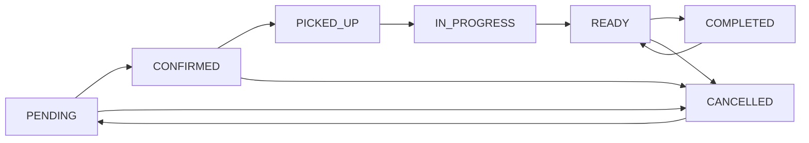

# Issue 03 - Admin console UX: two hidden order statuses, silent change failures, page-local totals

The admin console exposed five of the seven order statuses the data model defines and silently
rewrote the other two, omitted the fields fulfilment needs from the order detail page, discarded the
result of every status and payment change, computed its summary figures from the ten rows currently
displayed, never wrote a notification row, pointed the header search at a route the application does
not implement, and redirected an expired session to an API endpoint. A service's duration was
labelled in days on two surfaces and hours on three.

Change: `openspec/changes/fix-admin-console-ux` (schema `spec-driven`, language `en`).
Present in the working tree, not committed. "Before" line references below are from `HEAD`
(commit `4b2d20a`), which is also the diff base of `git diff`.

## Status

Implemented, verification partially pending.

Ticked: 8 of 23 tasks in `openspec/changes/fix-admin-console-ux/tasks.md` (1.1, 1.2, 2.1, 2.2, 5.3,
6.1, 6.3, 7.2) - every task whose stated verification is an offline check (a unit test, a source
assertion, or a type/lint gate) and each carries its own verification sentence in that file.

Pending part: tasks **1.3, 3.1-3.3, 4.1-4.3, 5.1, 5.2, 6.2, 7.1 (partly done, needs a decision),
7.3, 7.4, 8.1, 8.2 (partly done)**. Their code is present in the working tree; their stated
verification needs a database-backed run, a real administrator session, or a running application.
This checkout has no `.env` (only `.env.example`), so no console page can boot, no Prisma query can
run, and no session exists here. See "Pending verification".

## Scope

Covered:

- One authoritative status model and transition graph for the console (`admin-order-management`).
- An order detail view carrying the fields an operator fulfils an order from
  (`admin-order-management`).
- Operator-visible feedback for status and payment changes, and for bulk delete
  (`admin-order-management`).
- Summary figures that describe the whole filtered result set (`admin-order-statistics`).
- A notification writer plus a refresh path for the notification indicator, or removal of the
  feature (`admin-notifications`).
- Console navigation that resolves to implemented destinations, and expired sessions that return to
  sign-in (`admin-navigation`).
- One declared duration unit with a bounded validator for the service catalogue
  (`admin-service-catalogue`).

Deliberately left out (recorded in `proposal.md` and `design.md`, both under
`openspec/changes/fix-admin-console-ux/`):

- Authorization of the console and its endpoints (`harden-auth-and-admin-guards`).
- Removing dead code, dependencies and stale documentation (`remove-dead-code-and-slop`).
- Customer-facing placeholder content (`fix-customer-facing-placeholders`).
- Customer-list pagination, export formats, and any new administrative feature such as user
  management or an audit-log viewer. The customer list still loads every customer with every order
  and filters client-side; that scaling problem is real but is not this change.
- Automated end-to-end coverage of the console; the change records a documented manual pass plus
  unit tests for the transition graph and the aggregate query.

## Symptoms

Cluster 1 - the console hid two of the seven stored order statuses.

- `prisma/schema.prisma` `enum OrderStatus` defines seven values
  (`PENDING`, `CONFIRMED`, `PICKED_UP`, `IN_PROGRESS`, `READY`, `COMPLETED`, `CANCELLED`); the
  console exposed five.
- `app/admin/orders/components/OrderStatusBadge.tsx:17-23` declared `ADMIN_STATUSES` with
  `PENDING, CONFIRMED, READY, COMPLETED, CANCELLED`, which filtered the selector options.
- `app/admin/orders/components/OrderStatusBadge.tsx:45-53` declared `STATUS_FLOW`, which never
  routed through `PICKED_UP` or `IN_PROGRESS` (both mapped only to `READY`).
- The display rewrite lived in `normalizeStatus` (pre-fix `OrderStatusBadge.tsx:55-60`), applied at
  `:70` with `const current = normalizeStatus(status);`, which mapped `PICKED_UP` and `IN_PROGRESS`
  to `READY` for display.
  Command: `git show HEAD:app/admin/orders/components/OrderStatusBadge.tsx | grep -n 'normalizeStatus\|PICKED_UP\|IN_PROGRESS'`
  -> `55:function normalizeStatus...` / `56: if (status === "PICKED_UP" || status === "IN_PROGRESS")` /
  `70: const current = normalizeStatus(status);`
- `app/admin/orders/components/OrderFilters.tsx` listed five statuses as its own filter options.

Note: `proposal.md` cites `OrderStatusBadge.tsx:17-33` for the normalisation. In the file, lines
17-23 are `ADMIN_STATUSES` and 25-33 are `STATUS_LABEL`; the function that rewrites the value is
`normalizeStatus` at 55-60. The code is the authority here, and both halves are cited above.

Cluster 2 - the order detail view omitted what fulfilment needs.

- `app/admin/orders/[id]/OrderDetailView.tsx` was 88 lines
  (`git show HEAD:'app/admin/orders/[id]/OrderDetailView.tsx' | wc -l` -> `88`) and rendered only the
  order number, the two statuses, customer name/email, service lines and the total - no pickup
  address, pickup date, phone number, payment method, customer notes, internal notes, payment-proof
  reference or status history.

Cluster 3 - status and payment changes discarded their result.

- `app/admin/orders/components/OrderStatusBadge.tsx:83-85` fired `updateOrderStatusAction(orderId,
  next)` inside `startTransition` and ignored the returned value.
- `app/admin/orders/components/PaymentStatusBadge.tsx:41-44` did the same with
  `updatePaymentStatusAction(orderId, next)`. A failed change looked like a completed one, because
  the view refreshed nothing and reported nothing.
- `Toaster` was already mounted in the console layout and unused for this
  (`app/admin/layout.tsx:29`, `<Toaster />`; the import is `app/admin/layout.tsx:10`).

Note: `proposal.md` cites `app/admin/layout.tsx:15` for the mounted `Toaster`. In the file, line 15
is `export default async function AdminLayout(`; the element is at line 29. The code is the
authority here.

Cluster 4 - the orders page summarised the current page, not the result set.

- `app/admin/orders/page.tsx:52-62` derived `paidOrders`, `unpaidOrders` and `totalRevenue` from
  `result.data.filter(...)` - the ten rows of the page currently displayed - while sitting next to
  `result.total`, the true count.

Cluster 5 - the notification feature had no writer and no refresh.

- Nothing in the repository wrote a `Notification` row:
  `git grep -n 'notification.create\|notification.createMany' HEAD -- app lib actions components`
  -> no match. The bell could therefore never light up.
- `components/layout/AdminHeader.tsx:36-57` fetched the list once in a `useEffect(..., [])` with no
  interval and no focus listener, so an open console never saw a change.

Cluster 6 - navigation to routes that do not exist, and sessions sent to an API endpoint.

- `components/layout/AdminHeader.tsx:62` pushed
  `router.push(\`/admin/search?q=${...}\`)`; the application implements no `/admin/search` route.
- `app/admin/service/page.tsx:40` and `app/admin/service/new/page.tsx:65` redirected an expired
  session with `router.push("/api/auth/login")`, an API endpoint rather than the sign-in page.
- `components/layout/AdminSidebar.tsx` marked an item active by an exact path comparison, so a
  detail page (`/admin/orders/12`) did not highlight its list item.

Cluster 7 - one service duration field carried four units.

- Labelled days in the create form: `app/admin/service/new/page.tsx:290`
  (`<span>Durasi Pengerjaan (hari)</span>`).
- Hinted as hours in the edit form: `app/admin/service/[id]/EditForm.tsx:316`
  (`Estimasi waktu dalam jam (1-168)`), with `max="168"` at `:309` and `placeholder="24"` at `:312`.
- Shown as hours on the detail page: `app/admin/service/[id]/page.tsx:172`
  (`{product.duration} jam`).
- Shown as days in the table: `app/admin/service/ProductsTable.tsx:209`
  (`{product.duration} hari`).

Cluster 8 - operator-facing browser prompts and an unchecked bulk operation.

- `app/admin/service/ProductsTable.tsx:61-115` used `alert("Gagal hapus")` (line 71) and
  `confirm("Hapus yang dipilih?")` (line 103).
- The bulk delete at `app/admin/service/ProductsTable.tsx:105-110` awaited the `fetch` and then
  called `onRefresh?.()` regardless of the response, refreshing as if the operation had succeeded
  (`:114` reported only a network throw).

## Root cause

- Status model: presentation and transitions were owned by each component, so five definitions
  drifted apart. The console kept a five-value allow-list and a display normaliser for a two-value
  gap, which is exactly how two stored statuses became invisible and unselectable.
- Detail view: the page rendered the fields a list row needs rather than the fields a fulfilment
  operator needs, so pickup address, pickup date, phone, payment method, notes, proof reference and
  status history were never read from the order record.
- Change feedback: the server actions already returned a result object, but the badges awaited
  neither it nor an error path and there was no confirmation step, so success and failure were
  indistinguishable to the operator; `Toaster` was mounted but never called.
- Summary figures: the page component received `result.total` and `result.totalPages` yet derived
  its own counts from `result.data`, the current page's slice, so the figures answered the wrong
  question.
- Notifications: the `Notification` model existed and the documentation advertised the feature, but
  no code path created a row and the header fetched once on mount, so the feature had neither a
  writer nor a refresh.
- Navigation and sessions: several controls were written against routes that were never
  implemented - `/admin/search` and `/api/auth/login` treated as a page - and the active-item check
  compared exact paths.
- Duration: the unit was a free-text label in each surface rather than one declared value, so one
  number was entered under four different statements; nothing validated the value against a range.
- Bulk operation: the response was never inspected, so a failed delete was presented as a success.

## Fix

Grouped by area. All paths are relative to the repository root.

### A. One status model

`lib/constants.ts`:

- `:48` adds `ORDER_STATUS_TRANSITIONS`, a mapping from each stored status to the statuses reachable
  from it, covering all seven values:
  `PENDING -> CONFIRMED | CANCELLED`, `CONFIRMED -> PICKED_UP | CANCELLED`,
  `PICKED_UP -> IN_PROGRESS`, `IN_PROGRESS -> READY`, `READY -> COMPLETED | CANCELLED`,
  `COMPLETED -> READY`, `CANCELLED -> PENDING`.
- `:59` adds `ORDER_STATUS_DESTRUCTIVE: OrderStatus[] = [OrderStatus.CANCELLED]`, the statuses whose
  transition destroys work already promised to the customer.

The transition graph, as data:



The divergent copies were deleted:

- `app/admin/orders/components/OrderStatusBadge.tsx` - the local `STATUS_LABEL` and `STATUS_COLOR`
  maps, the `STATUS_FLOW` graph, the `ADMIN_STATUSES` filter and `normalizeStatus` are gone; the
  component imports `ORDER_STATUS_COLORS`, `ORDER_STATUS_LABELS`, `ORDER_STATUS_TRANSITIONS` and
  `ORDER_STATUS_DESTRUCTIVE` from `@/lib/constants`, and renders the selector directly from
  `ORDER_STATUS_TRANSITIONS[current]`.
- `app/admin/orders/components/OrderFilters.tsx` - the five-option status list is replaced by
  `...ORDER_STATUS_OPTIONS` and `...PAYMENT_STATUS_OPTIONS` from `@/lib/constants`.
- `app/admin/customers/components/OrderHistoryTable.tsx` - the third colour map and the second label
  map are removed; the table uses `ORDER_STATUS_COLORS` and `ORDER_STATUS_LABELS`.

Rejected alternative (`design.md` 1 and 2): keeping presentation local to each component - that is
what produced four disagreeing truths; branch logic instead of a data graph - the business can tune
the graph and the tests pin it, not the UI.

### B. Order detail completeness

`app/admin/orders/[id]/OrderDetailView.tsx` is now 215 lines and renders:

- Customer (name, phone, email, order number).
- "Pickup & Pembayaran" (pickup address with city, pickup date, payment method, payment-proof
  reference, created, completed).
- Catatan (customer notes, internal notes, or one statement when neither exists).
- Services, and "Riwayat Status" (per-entry status, timestamp, note).

Absent values render statements, not empty labels: "Belum dijadwalkan",
"Belum diunggah", "Tidak ada catatan pelanggan maupun catatan internal untuk pesanan ini." and
"Belum ada riwayat status tercatat."

### C. Change feedback

- `app/admin/orders/components/OrderStatusBadge.tsx` and
  `app/admin/orders/components/PaymentStatusBadge.tsx` now read the returned result
  (`await updateOrderStatusAction(...)`, `result?.success`), report it through the mounted toast
  component (`toast.success` / `toast.error`) and call `router.refresh()` after a success.
- New `components/ui/confirm-dialog.tsx` wraps the project's existing `AlertDialog` (title,
  description, confirm label, `destructive` variant). A destructive transition
  (`ORDER_STATUS_DESTRUCTIVE` in the status badge, `PAYMENT_DESTRUCTIVE`)
  and reopening a final state (`COMPLETED` or `CANCELLED`) go through it, so no browser `confirm()`
  remains in the console files.
- `app/admin/service/ProductsTable.tsx`: the `alert()` calls became toasts, the bulk delete reads
  the response and returns before refreshing on failure
  (`if (!res.ok || !result?.success) { toast.error(...); return; }`), and its confirmation uses the
  same dialog.

Rejected alternative (`design.md` 4): local state updates after a change - the server action already
revalidates the affected paths.

### D. Summary figures

- `lib/orderService.ts` `getAllOrders` (`:198`) adds, alongside the paginated query and the count,
  a `groupBy` on `paymentStatus` (`:244`) and an `aggregate` with `_sum: { totalPrice: true }`
  (`:249`). The `groupBy` runs over the same `where` as the paginated query; the aggregate narrows
  that `where` further to `paymentStatus: PAID`, because it sums only the paid total. It returns
  `summary: { paid, unpaid, refunded, paidRevenue }` (`:264`).
- `app/admin/orders/page.tsx` renders `result.summary` (`const { paid, unpaid, paidRevenue } =
  result.summary;`) and labels each figure "(sesuai filter)", with the header line stating
  "Total lunas (sesuai filter)". The page no longer derives any figure from `result.data`.

Rejected alternative (`design.md` 3): aggregating in the page by loading every matching order -
that defeats pagination.

### E. Notifications

- `lib/orderService.ts:282` adds `notifyAdminsOfNewOrder`: it loads the active administrators
  (`where: { role: "ADMIN", isActive: true, deletedAt: null }`) and writes one `Notification` row
  per administrator with a single `prisma.notification.createMany`, all inside a `try/catch` that
  logs (`console.error("Failed to write order notifications:", error)`) and swallows, so an
  unwritable notification never fails the order.
- `actions/orderActions.ts:269` calls it after the order row is created.
- `components/layout/AdminHeader.tsx` now fetches on an interval
  (`setInterval(fetchNotifications, NOTIFICATION_POLL_MS)`, `NOTIFICATION_POLL_MS = 15000`) and on
  `window` focus, cancels its work on unmount, and sends a refused request (401) to `/auth/login`.
- `README.md` gained a `### Operator notifications` subsection documenting the writer, the cap
  (`take: 50`) and the retention decision plus a cleanup statement.

Rejected alternative (`design.md` 5): websockets or server-sent events for notifications - an extra
always-open connection, badly suited to a serverless host and unnecessary for a single-operator
console. Accepted consequence: the indicator is eventually consistent within the polling interval.

### F. Navigation and sessions

- The header search now submits to `/admin/orders?search=...`, the implemented order search. The
  dead mobile search button and its spacer were removed, leaving one search control that works at
  every breakpoint.
- Every console fetch (service list, create form, edit form, header notifications) handles a 401 by
  going to `/auth/login`; no console file targets `/api/auth/login`.
- `lib/utils.ts:60` adds `isActiveNavItem(pathname, href)` and `components/layout/AdminSidebar.tsx`
  uses it (`:85`), so a detail page such as `/admin/orders/12` highlights the same item as its list
  page.

Rejected alternative (`design.md` 6): building a cross-entity `/admin/search` - new scope for a
control that has never worked.

### G. Duration unit

- `lib/constants.ts:102-110` declares `SERVICE_DURATION_UNIT` ("hari"),
  `SERVICE_DURATION_MIN_DAYS` (1), `SERVICE_DURATION_MAX_DAYS` (30),
  `SERVICE_DURATION_RANGE_LABEL` (`"1-30 hari"`) and `formatDuration(days)`.
- The create (`app/admin/service/new/page.tsx`) and edit
  (`app/admin/service/[id]/EditForm.tsx`) forms take their label, `min`, `max` and hint from those
  constants; the edit form's `max` went 168 -> 30, its placeholder 24 -> 3, and its hint no longer
  says hours.
- The service table (`app/admin/service/ProductsTable.tsx`) and the detail page
  (`app/admin/service/[id]/page.tsx`) render `formatDuration(...)`.
- `app/admin/service/[id]/page.tsx:36` now reads through `getProductById` instead of calling Prisma
  directly.
- `lib/productService.ts:56` adds `parseDurationDays`, which refuses a missing value and any
  non-integer or out-of-range value with a message naming the field (`Durasi`) and the accepted
  range; it is used by `createProduct` (`:133`) and `updateProduct` (`:180`).

Rejected alternative (`design.md` 7): storing a unit per service - schema and UI for a business that
has never quoted hours.

## Evidence

Recorded runs of the engineering pass, with observed results:

```
$ npx tsc --noEmit
(no output, exit code 0)                                     TSC OK

$ npm test                                                   (node:test + tsx)
tests 37 | pass 37 | fail 0
  tests/admin-console-ux.test.tsx   17 pass   (added by this change)
  tests/business-config.test.ts      7 pass
  tests/payment-step.test.tsx        4 pass
  tests/security-policy.test.ts      5 pass
  tests/success-view.test.tsx        4 pass

$ npm run lint
X 78 problems (57 errors, 21 warnings)

$ openspec validate "fix-admin-console-ux"
Change 'fix-admin-console-ux' is valid

$ openspec instructions apply --change fix-admin-console-ux --json
progress: { total: 23, complete: 8, remaining: 15 }   state: "ready"
```

For lint, the 78 problems (57 errors, 21 warnings) are byte-for-byte the problem count of the
baseline recorded before the change at `D:\AGENT\crazwash-baseline-lint.txt` (57 errors, 21
warnings). A per-file comparison showed no file gained or lost an issue, and the two files touched
most by this change (`app/admin/orders/components/OrderFilters.tsx` and the new test file) match the
baseline count. The lint baseline is pre-existing and is not claimed to be clean.

`tests/admin-console-ux.test.tsx` (17 tests) asserts, without a database. It sets a dummy
`DATABASE_URL` at `tests/admin-console-ux.test.tsx:18` so that `lib/prisma.ts` can construct a
client; no query is issued. The 17 tests assert:

- Every stored status has a label, a colour and at least one reachable transition, and every stored
  status is selectable somewhere in the graph.
- The console keeps one definition of status presentation (the canonical import, with `STATUS_FLOW`,
  `normalizeStatus`, `ADMIN_STATUSES`, the local label map, the history table's
  `orderStatusColor`/`translateOrderStatus`, and the five-option filter list all absent).
- Rendering the badge with a stored `IN_PROGRESS` and with a stored `PICKED_UP` shows each own label
  and never the `READY` label.
- The detail view renders all eight fulfilment values and degrades on a sparse fixture to the
  replacement statements.
- Both badges read the action result and refresh the view.
- No browser `confirm(` / `alert(` remains in the three console files; the dialog gates the cancel
  transition.
- The bulk delete checks the response and returns before refreshing.
- The summary is computed by the service (a `groupBy`, an `aggregate`, and a `summary`), the page
  reads it, and no page figure is derived from the current page.
- The notification writer and the capped (`take: 50`), guarded read path exist, and the header polls
  and listens for focus.
- Every `router.push`/`router.replace` target in the console resolves to an existing page file.
- The header search reaches the order search.
- No console file redirects to `/api/auth/login`.
- The navigation matcher covers nested routes.
- The duration unit and range are declared once, no hour-based duration label survives, and the
  detail page reads through the product service.
- The duration validator rejects `0`, `31`, `2.5`, `-1`, `"abc"` and a missing value, each naming the
  field and the accepted range.

Pre-change absences, from `HEAD`:

```
$ git show HEAD:'app/admin/orders/[id]/OrderDetailView.tsx' | wc -l                -> 88
$ git grep -n 'notification.create\|notification.createMany' HEAD -- app lib actions components -> no match
$ git show HEAD:app/admin/service/[id]/EditForm.tsx | grep -n 'max=\|placeholder="24"\|dalam jam'
   309 max="168" / 312 placeholder="24" / 316 Estimasi waktu dalam jam (1-168)
```

## How to verify

Offline, no database needed:

1. `npx tsc --noEmit` - expect no output and exit code 0.
2. `npm test` - expect `tests 37`, `pass 37`, `fail 0`, of which 17 come from
   `tests/admin-console-ux.test.tsx`.
3. `node --import tsx --test tests/admin-console-ux.test.tsx` - expect `pass 17`, `fail 0`.
4. `npm run lint` - expect `78 problems (57 errors, 21 warnings)`, matching the recorded baseline;
   no new finding is claimed.
5. `openspec validate "fix-admin-console-ux"` - expect `Change 'fix-admin-console-ux' is valid`.
6. `openspec instructions apply --change fix-admin-console-ux --json` - expect
   `progress: { total: 23, complete: 8, remaining: 15 }`, `state: "ready"`.
7. `grep -rn 'confirm(\|alert(' app/admin/orders/components app/admin/service/ProductsTable.tsx` -
   expect no browser prompt in those files.
8. `grep -rn '/api/auth/login' app/admin components/layout` - expect no match.

With a running application and a writable database - copy `.env.example` to `.env`, fill
`DATABASE_URL`, `NEXTAUTH_URL`, `NEXTAUTH_SECRET` and the business keys, run `npm run prisma:reset`,
then `npm run dev` (the checkout has no `.env` today, so none of the following has been run):

9. Store a test order and set it in turn to each of the seven statuses from the console - expect the
   stored value to match the selected status each time, including `PICKED_UP` and `IN_PROGRESS`.
10. Force a failed status or payment change - expect a failure toast and the displayed status to
    stay equal to the stored value.
11. Choose Cancel from the status selector - expect the console dialog to gate it, so the cancel
    cannot be applied without confirmation.
12. Induce a failed bulk delete - expect a failure toast and no refresh as if it had succeeded.
13. Compare the summary figures on page one and page two with the same filter, against a filter, and
    with a filter matching nothing - expect identical figures across pages, figures that follow the
    filter, and zero when nothing matches.
14. Place an order - expect one unread notification row per active administrator, and the header
    indicator to update within the polling interval without a manual reload.
15. Clear the session and load a console page - expect a redirect to `/auth/login`.
16. Compare the service detail values against the service table - expect the same values in the same
    unit.

## Pending verification

The checkout has no `.env` (only `.env.example`), so no console page can boot here, no Prisma query
can run and no session exists. The following tasks stay unticked in
`openspec/changes/fix-admin-console-ux/tasks.md`; each needs the resource named:

- 1.3 - moving one test order through each status in sequence and checking the stored value after
  each change. Needs a database and an admin session. The selector is rendered from the graph and
  the graph is asserted to reach all seven statuses offline, but the ordered walk was not run.
- 3.1 - inducing a failed status or payment change to see the failure message. Needs a live server
  action. The result is read and reported on both paths and a success refreshes the view (asserted
  offline).
- 3.2 - confirming by interaction that cancel cannot be applied without the dialog. Needs a browser.
  The dialog gates the transition and no browser `confirm` remains (asserted offline).
- 3.3 - inducing a bulk-delete failure and confirming the operator sees it. Needs a live endpoint.
  The response check, the failure toast and the early return before the refresh are asserted offline.
- 4.1, 4.2, 4.3 - comparing summary figures across page one and page two, against a filter, and in
  the empty-filter case. Need a database. The service returns the aggregate from the same filter as
  the paginated query, the page renders it, and the labels state the population (all asserted
  offline).
- 5.1, 5.2 - observing an unread notification row after an order, and watching the indicator update
  without a manual reload (and that read state survives a reload). Need a database and a running
  app. The writer is implemented in the order service and called from the order-creation action, and
  the header polls every 15s and on window focus (asserted offline).
- 6.2 - clearing the session and loading a console page to observe the sign-in redirect. Needs a
  running app. Every console fetch handles 401 by going to `/auth/login` and no console file targets
  `/api/auth/login` (asserted offline).
- 7.1 (partly done) - the five-surface clause: the unit, the range and the formatter are declared
  once and the hour-based hint and detail label are gone, so four of the five surfaces are verified
  offline. The fifth surface cannot show the same value, because the customer-facing catalogue
  renders no duration at all today. Needs a decision.
- 7.3 - comparing the rendered service detail values against the service table. Needs a database.
  The page now reads through `getProductById` (asserted offline).
- 7.4 - reviewing the catalogue with the business to correct any service whose stored duration was
  entered as hours. Needs the user and the business; this cannot be done from the repository.
- 8.1 - the end-to-end console walkthrough (list, filter, summary, detail, each status change,
  notification arrival, expired session). Needs a running app with a session and a database.
- 8.2 (partly done) - the remaining clause is "no console figure disagrees with the database". The
  route scan, `npx tsc --noEmit` (0 errors), the lint baseline (57 errors / 21 warnings, unchanged)
  and the 17 tests added by this change all pass offline.

To close any of them: a `.env` with a live database and a running application with an administrator
session. No `.env` exists in this checkout, so none could be run here.

## Follow-ups / out of scope

- **Second order-creation path (task 5.1).** `app/api/orders/route.ts` also creates orders and does
  not write a notification. It was deliberately left untouched because `remove-dead-code-and-slop`
  deletes that route; until that lands, orders created through it produce no notification.
- **Status-history writer.** Console status changes go through `lib/orderService.ts`
  `updateOrderStatus`, which does not append to `Order.statusHistory`. The only writer,
  `actions/orderActions.ts` `updateOrderStatus`, is exported but unused, so the detail view's new
  history section is empty for console-driven changes. Not covered by any task in this change.
- **Notification retention (task 5.3) is a decision, not pruning.** The read path returns the newest
  50 rows per administrator and older rows are kept; `README.md` documents the cleanup statement.
- **Service duration, fifth surface (task 7.1).** The customer-facing catalogue renders no duration
  at all - `app/(public)/services/ServicesView.tsx` receives a `products` prop it never uses (it is
  declared at line 31 and destructured at line 93, which carries the `'products' is defined but
  never used` lint warning), so only the marketing copy "Pengerjaan 1-3 hari kerja" refers to days
  there. Displaying the stored duration on the public catalogue is a product decision, not a unit
  fix.
- **Excluded by the change's proposal.** Customer-list pagination (the page still loads every
  customer with every order and filters client-side), export formats, and new administrative
  features such as user management or an audit-log viewer. Authorization of the console belongs to
  `harden-auth-and-admin-guards` (its implementation is merged on this branch, but its own
  `tasks.md` still shows 4/21 ticked); dead-code removal belongs to `remove-dead-code-and-slop`;
  customer-facing placeholder content to `fix-customer-facing-placeholders`.
- Rotate `NEXTAUTH_SECRET` when deploying, so sessions carrying the pre-change hardcoded role are
  invalidated (stated in `README.md` Notes and in the `harden-auth-and-admin-guards` migration plan).
- Run `openspec validate fix-admin-console-ux` (already valid) and archive the change once the
  group 8 walkthrough passes against a deployed environment.
