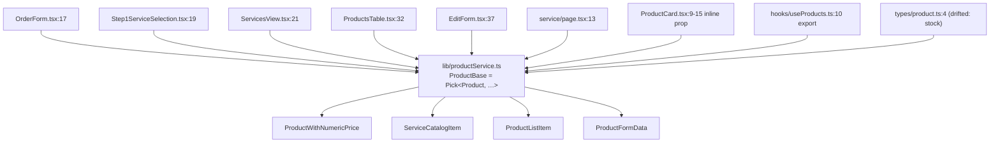

# Issue 04 - Repository dead weight: unreferenced routes, duplicated definitions and stale documentation

The repository carried code and documentation that nothing reached and that no reader could trust. Two
in-repo READMEs described an API surface and a rendering model the code does not implement; one of
them documented a request method the handler does not implement and two endpoints that were never
written. An unused hook fetched `/api/admin/products`, a route that has never existed, and documented
a different route again. A page file imported itself, so a file named like a route looked like a
working one. One concept - the product shape - had eight hand-written definitions, and the shape that
lived in `types/` had already drifted from `prisma/schema.prisma`; one currency formatter existed in
seven places, and an order number was built from `Math.random()`. Eighteen `console.log` calls,
marker comments from earlier passes, ten `suppressHydrationWarning` attributes and a `.dark` palette
with no `.dark` ancestor added noise to every read. Nothing in the repository ran a typecheck, a lint
or a test on push, so none of it was ever caught.

Change: `openspec/changes/remove-dead-code-and-slop` (schema `spec-driven`, language `en`,
`skip_specs: true` - it deliberately declares no spec deltas because it changes no behaviour).

Committed and pushed. Branch `chore/remove-dead-code-and-slop` on `origin`
(`athallaarl66/Crazwash`), two commits:

- `5da330e` - `chore: remove dead code, duplicated shapes and generator noise` (the change itself).
- `51c7d5e` - `docs(openspec): record the verification evidence for remove-dead-code-and-slop` (the
  task-file evidence).

"Before" line references below are from `b67d026`, the `main` HEAD the branch started from and the
diff base of the change.

## Status

Implemented, verification complete.

All **23 of 23** tasks in `openspec/changes/remove-dead-code-and-slop/tasks.md` are ticked, and each
ticked line carries its own verification sentence after `— `; that file is the source of truth for
requirements. The change declares no spec deltas (`skip_specs: true`), so there is no capability
specification to validate against: it removes unreached code, collapses duplicated definitions and
adds a quality gate, and changes no behaviour.

Two items remain open and are recorded under "Pending verification", not here: the control inventory
for four admin pages was cut short when the browser daemon died, and the whole verification ran
against a local throwaway database rather than a deployment.

## Scope

Covered:

- Deletion of every source file and route handler nothing reaches.
- One definition per concept: the product shape, currency formatting, the order number, and the order
  creation path.
- Removal of the READMEs that contradicted the code, and of the dependencies and configuration
  nothing uses.
- Removal of the comment, `console.log`, `suppressHydrationWarning` and dead-CSS noise earlier passes
  left behind.
- Re-encoding of six committed photographs to WebP, which `ServicesView.tsx` no longer references as
  JPEGs.
- A CI workflow that typechecks, generates the Prisma client and Next types, lints and tests on every
  push and pull request.

Deliberately left out (recorded in `proposal.md` and `design.md`, both under
`openspec/changes/remove-dead-code-and-slop/`):

- Behaviour changes of any kind. The change touches no reachable code path, which is why it declares
  no spec deltas.
- The stale documentation under `docs/projects/` (see "Follow-ups / out of scope").
- The 74 pre-existing lint findings, the `metadataBase` metadata warning, the `next/image` dimension
  warning, the unformatted `Total` column in the orders CSV export and the hardcoded footer contact
  number. These are real but are not dead code.
- Rewriting git history to drop the original JPEG blobs (see "Assets").

## Symptoms

Cluster 1 - two in-repo READMEs described an API surface the code does not implement.

- `app/api/README.md:7` asserted "All `/api/admin/*` routes require a session with `role ===
  \"ADMIN\"`". The guard is per handler and not uniform: the admin handlers call
  `adminGuardResponse()` (`lib/api-error-handler.ts:263`), while
  `app/api/admin/notifications/route.ts:4` calls `requireAdmin` (`lib/api-error-handler.ts:219`)
  instead.
- `app/api/README.md:3` claimed "Auth is checked via `getServerSession` from NextAuth". The guards
  read the stored account through `lib/api-error-handler.ts`; no handler calls `getServerSession`.
- `app/api/README.md:29` documented `GET | PUT | DELETE /api/admin/service/[id]`;
  `app/api/admin/service/[id]/route.ts` implements `GET` (`:6`), `PATCH` (`:43`) and `DELETE` (`:81`)
  - no `PUT`.
- `app/api/README.md:49` and `:53` documented `GET /api/products/[id]` and `GET /api/products_get`;
  neither route file has ever existed.
- `app/api/README.md:43` documented `GET | PATCH /api/orders/[id]`, a route the UI never calls.
- `app/admin/README.md:24` stated "This page is fully server-rendered"; the dashboard page is a client
  component that fetches `/api/admin/dashboard`, which the same file then documented at `:18`.
- `app/admin/dashboard/README.md:15` listed an `AlertsPanel` component. No such component exists
  anywhere in `app/` or `components/`.
- `hooks/README.md:7` stated the hook "Fetches the list of active products from `/api/products_get`".
  The hook fetches `/api/admin/products` (`hooks/useProducts.ts:59`), and neither path is what the
  application uses.
- `prisma/README.md:43` documented `npm run prisma:seed-admin`; `package.json` declares no such
  script.
- The root `README.md` claimed the framework is `Next.js 15` (`:9`) while the dependency is
  `next ^16.1.6`; documented `npx prisma db push` (`:42`) while `npm run build` runs
  `prisma migrate deploy`; stated the seed creates "sample orders" (`:44`) while `prisma/seed.ts`
  creates administrator accounts and services only; documented `prisma:seed-admin` (`:192`); and said
  "some hooks and components are intentionally left as stubs" (`:206`).

Command that shows the pre-change text, one file at a time:

```
$ git show b67d026:app/api/README.md | grep -n 'ADMIN\|PUT\|getServerSession\|products_get\|products/\[id\]'
3: Auth is checked via `getServerSession` from NextAuth.
7: All `/api/admin/*` routes require a session with `role === "ADMIN"`.
29: ### `GET | PUT | DELETE /api/admin/service/[id]`
49: ### `GET /api/products/[id]`
53: ### `GET /api/products_get`
```

Cluster 2 - an unused hook pointed at a route that does not exist.

- `hooks/useProducts.ts` had no importer: `git grep -n 'useProducts' b67d026 -- app components lib
  actions tests` matched nothing outside the `hooks/` directory itself.
- It fetched `/api/admin/products` (`hooks/useProducts.ts:59`, and the mutate path at `:86`), a
  directory with no route file in the repository.
- `hooks/useProducts.ts:10` exported a seventh copy of the `Product` shape.

Cluster 3 - a self-importing page file looked like a working route.

- `app/(public)/landingpage.tsx` was five lines whose only import was its own file:
  `git show b67d026:'app/(public)/landingpage.tsx'` -> line 1 `import LandingPage from
  "./landingpage";`. The App Router never treated it as a route, because only `page.tsx` is one.

Cluster 4 - one concept had several hand-written definitions that had already drifted.

- Product shape. Eight copies existed: six local `interface Product` declarations
  (`app/(public)/order/components/OrderForm.tsx:17`,
  `app/(public)/order/components/steps/Step1ServiceSelection.tsx:19`,
  `app/(public)/services/ServicesView.tsx:21`, `app/admin/service/ProductsTable.tsx:32`,
  `app/admin/service/[id]/EditForm.tsx:37`, `app/admin/service/page.tsx:13`), the inline `product`
  prop type in `app/(public)/order/components/shared/ProductCard.tsx:9-15`, and the `Product` export
  of the deleted hook (`hooks/useProducts.ts:10`). A ninth, unreferenced copy lived in
  `types/product.ts:4`, and it had drifted from the schema: it declared `stock: number`
  (`types/product.ts:10`) while `model Product` in `prisma/schema.prisma` has no `stock` field, and it
  repeated category labels that already live in `lib/constants.ts`.
- Currency. Seven definitions produced the same rupiah string:
  `app/(public)/order/success/SuccessClient.tsx:51` (local `formatCurrency`),
  `app/admin/customers/[phone]/page.tsx:47` (`formatRupiah`), `app/admin/customers/components/
  CustomerTable.tsx:33` (local `formatCurrency`), `app/admin/customers/components/OrderHistoryTable
  .tsx:40` (local `formatCurrency`), `app/admin/dashboard/page.tsx:96` (local `formatCurrency`), and
  inline conversions at `app/admin/customers/components/CustomersClient.tsx:80`,
  `app/admin/dashboard/components/TopProductsTable.tsx:114` and `:132`,
  `app/admin/orders/page.tsx:108`, and two `"Rp " + …` cells at
  `components/ui/export-button.tsx:92` and `:96`.
- Order number. Two implementations built the number independently: a local `generateOrderNumber` in
  `actions/orderActions.ts:19` whose suffix was `Math.floor(Math.random() * 1000)`
  (`actions/orderActions.ts:21`, used at `:222`), and a literal `ORD-${Date.now()}` in the deleted
  `app/api/orders/route.ts:94`. A three-digit random suffix and a millisecond timestamp collide
  under load.
- Order creation. Two paths created an order with different validation:
  `actions/orderActions.ts` (the flow the checkout uses) and `POST /api/orders`
  (`app/api/orders/route.ts:7`), which the technical documentation recorded as unused.

Cluster 5 - non-route files that looked like routes, and unreferenced UI.

- `app/api/orders/route.ts` (126 lines), `app/api/orders/[id]/route.ts` (59 lines) and
  `app/api/service_get/route.ts` (20 lines) had no caller:
  `git grep -n 'api/orders' b67d026` matched only the stale `app/api/README.md:43`, documentation
  under `docs/`, and the two route files' own header comments; `git grep -n 'service_get' b67d026`
  matched only the route file's own header comment and `docs/`.
- `components/ui/dialog.tsx`, `components/ui/Modal.tsx` and `components/ui/radio-group.tsx` had zero
  importers. The only `RadioGroup` left in the tree belongs to the dropdown-menu primitive
  (`DropdownMenuRadioGroup`).
- `types/product.ts` and `types/orderTypes.ts` were imported by nothing; the only matches for their
  paths were their own first-line comments.

Cluster 6 - comment, log, attribute and CSS noise from earlier generator passes.

- 18 `console.log` calls in two files: eleven in `actions/orderActions.ts`
  (lines 60, 71, 85, 124, 148, 169, 192, 216, 223, 254, 261) and seven in
  `app/admin/service/[id]/EditForm.tsx` (lines 101, 102, 103, 120, 121, 122, 130). Removed: 18.
- Marker comments from earlier passes were left in the source, 21 in total at `b67d026`, among them
  `// ← TAMBAH KEY UNIK` twice and `// ← TAMBAH INDEX SEBAGAI FALLBACK` once in
  `app/(public)/order/components/cart/MobileCartSheet.tsx:52`, `:64`, `:96`;
  `// ← BENARIN PATH` three times in `app/layout.tsx:28`, `:38`, `:39`; three `🔥` notes in
  `actions/orderActions.ts:127`, `:277`, `:341`; and three `// ✅ TAMBAHIN:` notes attached to the
  logging in `app/admin/service/[id]/EditForm.tsx:100`, `:119`, `:139`. A grep for the marker patterns
  returns nothing in the cleaned tree.
- Ten `suppressHydrationWarning` attributes sat on elements whose ids already match between server and
  client, so each was masking nothing.
- `app/globals.css` carried a 50-line `.dark` palette and `tailwind.config.ts` carried
  `darkMode: "class"`, while no element in the application ever carries a `.dark` class.

Cluster 7 - nothing caught any of it.

- At `b67d026` the repository had no CI workflow: `.github/workflows/` did not exist. A typecheck, a
  lint run and the test suite were entirely manual, on a working tree that already carried 78 lint
  problems.

## Root cause

- Documentation was written per directory and never tied to the handlers it described, so the READMEs
  aged into fiction: a `PUT` where the handler implements `PATCH`, `getServerSession` where the guard
  reads stored state, two endpoints that were never written, a "fully server-rendered" page that is a
  client component, an `AlertsPanel` that does not exist, a seed script absent from `package.json`.
  A reader had no way to tell which sentence was still true.
- Files were named or written as if a framework convention applied without the convention actually
  matching: `landingpage.tsx` is not `page.tsx`, so a file that imports itself renders nowhere;
  `hooks/useProducts.ts` fetched a path no route serves and was never mounted, so its wrong path cost
  nothing and taught nothing until someone copied it.
- Each component declared the shape it needed inline, so one concept existed as many hand-written
  copies. Nothing coupled those copies to `prisma/schema.prisma`, so the copies drifted (`stock`) and
  were only discovered by reading. The same happened to the currency formatter and the order number.
- Two order-creation paths existed because the API route was written before the server action and
  kept afterwards; nothing deleted the older one, and the older one kept its own validation and its
  own `ORD-${Date.now()}`.
- Nothing gated a push, so no deletion, no stale claim and no duplication was ever mechanically
  surfaced: without a typecheck in CI, a whole-file deletion carries no signal, and without lint in
  CI the `console.log` and marker-comment count only ever grew.

## Fix

Grouped by area. All paths are relative to the repository root. `b67d026` is the "before" state.

### A. Deleted from the tree

| Path | Why it was dead |
| --- | --- |
| `app/api/orders/route.ts` | No caller anywhere; the path appears in no source file, only in its own header comment and the stale `app/api/README.md:43`. Reachable in production until this change. |
| `app/api/orders/[id]/route.ts` | No caller anywhere. It was an undocumented `PATCH` on an order; it did call `adminGuardResponse()` (`app/api/orders/[id]/route.ts:16` in the before state, added by Issue 02), so it was authorised dead weight, not an exposure. |
| `app/api/service_get/route.ts` | No caller. |
| `app/(public)/landingpage.tsx` | Not a route (no `page.tsx` name); its only import line was its own file. |
| `hooks/useProducts.ts` | No importer, and it fetched `/api/admin/products`, a route that has never existed; also exported a seventh copy of the `Product` shape. |
| `components/ui/dialog.tsx`, `components/ui/Modal.tsx`, `components/ui/radio-group.tsx` | Zero importers. The only remaining `RadioGroup` in the tree is the dropdown-menu primitive's own `DropdownMenuRadioGroup`. |
| `types/product.ts`, `types/orderTypes.ts` | Imported by nothing; `types/product.ts` declared a `stock` field that does not exist in `prisma/schema.prisma`, and repeated category labels that already live in `lib/constants.ts`. |
| `app/api/README.md`, `app/admin/README.md`, `app/admin/dashboard/README.md`, `prisma/README.md`, `hooks/README.md` | Each carried at least one claim the code contradicts (Cluster 1). The `hooks/` directory is gone. |
| `public/images/HCL_25.jpg`, `HCL_26.jpg`, `HCL_27.jpg`, `HCL_28.jpg`, `HCL_35.jpg`, `HCL_37.jpg` | Replaced by WebP encodes; see section F. |

The false claims were dropped rather than moved to a new document, because a claim about a route that
does not exist has no correct home:

- `app/api/README.md`: the `role === "ADMIN"` blanket statement, the `getServerSession` claim, `PUT`
  where the handler implements `PATCH`, the two non-existent `products` endpoints, and the order-route
  entry.
- `app/admin/README.md`: "fully server-rendered"; `app/admin/dashboard/README.md`: the `AlertsPanel`
  entry.
- `hooks/README.md`: the route the hook does not fetch.
- `prisma/README.md`: `npm run prisma:seed-admin`.
- Root `README.md`: `Next.js 15`, `npx prisma db push`, the "sample orders" claim, `prisma:seed-admin`,
  and the "intentionally left as stubs" sentence. It now states `Next.js 16` and
  `prisma migrate deploy`, matching `package.json`.

### B. Added

- `docs/api-reference.md` - the real route table with methods and the guard each handler calls, the
  `{ error: string }` envelope, and the `RateLimit`-backed order limit.
- `docs/admin-console.md` - the console page table, each page's rendering mode, the dashboard
  component inventory, and where status and currency vocabulary lives.
- `tests/lib-utils.test.ts`, `tests/order-creation.test.ts` (section G).
- `.github/workflows/ci.yml` (section H).
- `public/images/HCL_*.webp`, six files (section F).

### C. One definition per concept

Product shape. One place now, `lib/productService.ts`, derived from the generated Prisma model:

- `lib/productService.ts:38` - private `ProductBase = Pick<Product, "id" | "name" | "description" |
  "category">`.
- `:41` `ProductWithNumericPrice` (order flow), `:44` `ServiceCatalogItem` (public catalogue),
  `:47` `ProductListItem` (admin table), `:53` `ProductFormData` (admin edit form).

The eight hand-copied shapes they replace are listed in Cluster 4; all eight were deleted, and every
consumer now imports from `lib/productService.ts`.



Currency. One `formatCurrency` in `lib/utils.ts:9`. Removed: the copies in
`app/(public)/order/success/SuccessClient.tsx`,
`app/admin/customers/components/CustomerTable.tsx`,
`app/admin/customers/components/OrderHistoryTable.tsx`, `app/admin/dashboard/page.tsx`, the
`formatRupiah` in `app/admin/customers/[phone]/page.tsx`, and the inline
`Rp {…toLocaleString("id-ID")}` conversions in `CustomersClient.tsx`, `TopProductsTable.tsx` (two
places), `app/admin/orders/page.tsx`, and the two `"Rp " + …` cells in
`components/ui/export-button.tsx`. `lib/utils.ts:11` is now the only `style: "currency"` occurrence in
`app/`, `components/` and `lib/`; the two other occurrences in the tree are the legacy variants
`tests/lib-utils.test.ts:13` and `:18` keep on purpose, as the reference the shared helper has to
reproduce value for value. Deliberately left: the plain-number `Total` column in the orders CSV export
(`components/ui/export-button.tsx:73`), which carries no currency marker, and every
`toLocaleDateString`/`toLocaleString("id-ID")` used for dates.

Order number. One `generateOrderNumber` in `lib/utils.ts:42`:
`ORD-<YYYYMMDD>-<8 hex chars>` taken from `crypto.getRandomValues`, replacing a `Math.random()`
three-digit suffix. The two deleted implementations were the local one in `actions/orderActions.ts`
and the `ORD-${Date.now()}` literal in the deleted `app/api/orders/route.ts:94`. Duplicate safety is
two-layered: the wider suffix, and a retry loop in `createOrder` (`lib/orderService.ts:153`,
`isOrderNumberCollision` at `:164` matching Prisma `P2002`, `ORDER_NUMBER_ATTEMPTS = 4` at `:161`)
that regenerates the number when the unique index rejects the insert.

Order creation. One path: both the public checkout and any future caller go through `createOrder()` in
`lib/orderService.ts`, which also writes the `PENDING` status-history entry
(`lib/orderService.ts:119`) and calls `notifyAdminsOfNewOrder()` (`:145`, defined at `:338`).
`actions/orderActions.ts` keeps form parsing, validation, the rate limit
(`actions/orderActions.ts:90`) and the customer-account resolution, and reports an unknown service
through `InvalidServiceSelectionError` (`lib/orderService.ts:35`, thrown at `:83`, caught at
`actions/orderActions.ts:176`) so the customer still sees "Ada layanan yang tidak valid".

### D. Dependencies and configuration removed

- `package.json`: `swiper`, `otplib`, `qrcode`, `resend`, `@types/qrcode` (nothing imported them;
  `otplib`/`qrcode` were leftovers of the removed MFA feature) and `tw-animate-css` (never imported).
- `tailwind.config.ts`: `darkMode: "class"`, the `./pages/**` content glob (the directory does not
  exist) and the `accordion-down`/`accordion-up` keyframes and animations for
  `@radix-ui/react-accordion`, which is not a dependency.
- `app/globals.css`: the 50-line `.dark` palette (background/foreground/primary/secondary/accent/
  card/popover/muted/destructive/border/input/ring, shadows, chart colours). No `dark:` utility inside
  `components/ui/*` was touched - those are third-party shadcn sources and no `.dark` ancestor exists
  to activate them.

### E. Noise removed

- 18 `console.log` calls in the two cleaned files: eleven in `actions/orderActions.ts` (lines 60, 71,
  85, 124, 148, 169, 192, 216, 223, 254, 261) and seven in `app/admin/service/[id]/EditForm.tsx`
  (lines 101, 102, 103, 120, 121, 122, 130). The removed API route carried none. Kept deliberately:
  the `console.log` in `scripts/check-business-config.ts:21` (that
  script's build-time report) and every `console.error` (32 in the tree).
- 21 marker comments left by earlier passes, e.g. `// ← TAMBAH KEY UNIK` x2 and
  `// ← TAMBAH INDEX SEBAGAI FALLBACK`, `// ← REMOVE MoreVertical…`, `// ← FIX: tambah undefined`,
  `// ← BENARIN PATH` x3, `{/* ← TAMBAHIN INI buat favicon */}`, `// ← TAMBAH useEffect`,
  `// ← UPDATE: MARK AS READ / MARK ALL AS READ`, `// ✅ FIX:` x2, three `🔥` notes and three
  `// ✅ TAMBAHIN:` notes. The grep that finds them at `b67d026` finds nothing in the cleaned tree.
- 10 `suppressHydrationWarning` attributes: `<html>` in `app/layout.tsx`,
  `components/layout/AdminHeader.tsx`, `components/layout/AdminSidebar.tsx` (x2),
  `app/admin/orders/components/OrderFilters.tsx` (x3), `OrderStatusBadge.tsx`,
  `PaymentStatusBadge.tsx`, `components/ui/export-button.tsx`. **None had to be kept**: they sat on
  Radix-backed buttons, inputs and select triggers whose ids already match between server and client,
  so there was no underlying formatting difference to fix into place.

### F. Assets

Six committed photographs, each 3024x2005 and roughly 5 MB, were re-encoded once with `sharp` to WebP
at 1600x1061, quality 90: total **30.84 MB -> 2.33 MB (-92.4 %)**.
`app/(public)/services/ServicesView.tsx:30-47` now references the `.webp` files and renders each
through `next/image` with explicit `width={1600}` `height={1061}` (`:250-251`, `:272-273`) instead of
`fill`.

Git history still contains the original JPEG blobs; rewriting history was deliberately not performed,
because it would break existing clones and the deployed branch. That is an accepted trade-off, not a
fix.

### G. Tests

- `tests/lib-utils.test.ts` - asserts `generateOrderNumber`'s format and that 1000 numbers generated
  inside one millisecond are all distinct, and holds the four legacy currency variants as the
  reference `formatCurrency` must match value for value.
- `tests/order-creation.test.ts` - freezes the clock, creates two orders through `Promise.all`,
  asserts both are stored with distinct numbers and with the stored total, quantity and status-history
  entry, then deletes its own rows. It needs a database and skips itself when `DATABASE_URL` is absent,
  which is why the CI job needs no database service.

### H. Quality gate added

`.github/workflows/ci.yml` runs, on every push and pull request:
`npm ci` -> `npx prisma generate` -> `npx next typegen` -> `npx tsc --noEmit` -> `npm run lint` ->
`npm test`. Prisma generation and Next type generation are there because `tsconfig.json` includes
`.next/types` and the app imports the generated client, so a bare clone would otherwise fail the
typecheck. Lint is `continue-on-error: true` **on purpose**: the repository carries 74 pre-existing
lint problems and this change must not pretend they are gone. The test job needs no database because
the database-backed test skips itself when `DATABASE_URL` is absent.

## Evidence

Recorded runs of the engineering pass, with observed results. The engineer ran them; this document
reports them.

Environment for the run: a local `.env` (gitignored, in the repository root) pointing at a throwaway
database named `crazwash_verify` on the developer's own PostgreSQL service, seeded via
`prisma migrate deploy` (10 migrations) and `npm run prisma:seed` (2 administrator accounts, 19
services). The connection string is not reproduced here; it lives in that gitignored file. Tooling:
node v26.7.0, npm 11.19.0.

Baseline, at `b67d026` (before the change):

```
$ npm install --no-audit --no-fund
succeeded

$ npx tsc --noEmit
exit 0, no output (0 errors)

$ npm run lint
exit 1 - 78 problems (57 errors, 21 warnings) across 36 files

$ npx prisma generate
succeeded

$ npx next build
needs a reachable database (the change's design.md had assumed otherwise):
  no DATABASE_URL    -> fails collecting page data for /api/service_get
  unreachable URL    -> compiles and typechecks, then fails prerendering
                        /(public)/services on prisma.product.findMany()
  against crazwash_verify -> exit 0
```

Final, on the cleaned tree:

```
$ npx tsc --noEmit
0 errors

$ npm run lint
74 problems (54 errors, 20 warnings)

$ npm test
40 tests, 0 failures   (tests/order-creation.test.ts skips itself without DATABASE_URL)

$ npm run build
(business-config check -> prisma generate -> prisma migrate deploy -> prisma db seed -> next build)
exit 0
```

- Lint delta. The difference against the baseline is exactly the findings of the two deleted files
  (`app/api/service_get/route.ts`, `hooks/useProducts.ts`); the two remaining
  `components/layout/AdminSidebar.tsx` findings are the same findings at shifted line numbers
  (141->139, 162->160). No file gained a finding.
- Public order flow, walked in a browser: `/order` step 1 (one Sandal) -> step 2 (Verify Walkthrough /
  8123456799) -> step 3 (Jl. Verification No. 1, Bandung / pickup 2026-10-15 / notes) -> step 4
  (Transfer Bank, offered from `PAYMENT_DESTINATIONS`) -> submit produced
  `ORD-20261014-c75ff45a`; the success page showed the number, `Rp 30.000` and the method. The stored
  row was read back and holds the same fields as before the change: customer name, phone, empty email,
  address, `city=Bandung` (extracted from the address), pickup date, notes, `paymentMethod=TRANSFER`,
  `totalPrice=30000.00`, `status=PENDING`, `paymentStatus=UNPAID`, one `statusHistory` entry, one
  `OrderService` row (qty 1, unit 30000, subtotal 30000), `customerId` pointing at the customer record
  the action created, and one unread notification per active administrator.
- Same-millisecond duplicate check against the real database: `tests/order-creation.test.ts` freezes
  the clock, creates two orders through `Promise.all`, asserts both are stored with distinct numbers,
  asserts the stored total, quantity and status-history entry, then deletes its own rows - read back
  afterwards, the `Order`, `OrderService` and `Notification` counts return to 0.
  `tests/lib-utils.test.ts` additionally asserts 1000 numbers generated inside one millisecond are all
  distinct.
- The test command genuinely fails on a broken assertion: a throwaway test file containing
  `assert.equal(formatCurrency(50000), "Rp 999.999")` made `node --import tsx --test` exit 1; the file
  was deleted again.
- Hydration: the browser console was hooked before hydration ran and eleven surfaces were visited -
  `/`, `/order`, `/services`, `/admin/dashboard`, `/admin/orders`, `/admin/orders/7`,
  `/admin/service`, `/admin/service/new`, `/admin/service/7/edit`, `/admin/customers`,
  `/admin/customers/8123456799` - zero messages matching "hydrat". The only console output was
  unrelated Next warnings (missing `metadataBase`, and a pre-existing `next/image` width/height
  warning for `public/crazwash.svg`).
- Gallery: all three before/after pairs load the new files (`HCL_25`/`26`, `HCL_27`/`28`,
  `HCL_35`/`37`), every image reports `complete` with real natural dimensions, served through the Next
  image optimizer at `w=640` and displayed at 460 px. The original and the WebP describe the same
  photograph (same building, signage, cabling, umbrellas, colour grading); the only difference at full
  pixel size is slight high-frequency softening in the sky and cable detail.
- Theme: `<html>` carries no class, no element carries `.dark` (0 nodes), and `document.body` computes
  to `rgb(237, 237, 206)` on `rgb(12, 44, 85)` - the light tokens - so removing `darkMode: "class"`
  changed nothing reachable.
- Control inventory per page after the deletions: `/` 6 buttons/14 links; `/services` 10/13 including
  previous/next and the three "Go to image" controls; `/order` 8 buttons including four category tabs
  and "Selanjutnya"; `/admin/dashboard` 6 buttons/1 input; `/admin/orders` 11 buttons with two filter
  selects plus search; `/admin/orders/7` 5 buttons with the full detail; `/admin/service` 7 buttons
  including "Tambah Layanan" and "Refresh". (See "Pending verification" for the four pages this
  inventory does not cover.)
- README commands run as written: `cp .env.example .env`, `npx prisma migrate deploy` ("No pending
  migrations to apply."), `npm run prisma:seed`, `npm run dev` (200 on `/`, `/order`, `/services`),
  `npm run build`, `npm run lint`, `npm test`, `npx prisma studio` (answers 200 on `:5555`).
  `npm run prisma:reset` was **not** run - the README itself marks it destructive.
- CI: run `38504566836` (the change commit) and run `38504853394` (the evidence commit) both
  **succeeded**, every step green. The lint step reported 74 problems without failing the job; the
  test step reported 40 tests / 39 pass / 1 skipped / 0 fail.

Pre-change facts, from `b67d026` (the inventory this change acts on):

```
$ git show b67d026:'app/(public)/landingpage.tsx'
1: import LandingPage from "./landingpage";

$ git grep -n 'useProducts' b67d026 -- app components lib actions tests
no match outside hooks/

$ git grep -n 'service_get' b67d026 -- app components hooks lib actions
b67d026:app/api/service_get/route.ts:1:// app/api/service_get/route.ts

$ git grep -c 'suppressHydrationWarning' b67d026 -- app components
app/admin/orders/components/OrderFilters.tsx:3
app/admin/orders/components/OrderStatusBadge.tsx:1
app/admin/orders/components/PaymentStatusBadge.tsx:1
app/layout.tsx:1
components/layout/AdminHeader.tsx:1
components/layout/AdminSidebar.tsx:2
components/ui/export-button.tsx:1
(10 attributes in total)

$ git grep -n 'console\.log' b67d026 -- actions/orderActions.ts
11 lines (60, 71, 85, 124, 148, 169, 192, 216, 223, 254, 261)
```

## How to verify

Offline, from a clone of the branch `chore/remove-dead-code-and-slop`, no database needed:

1. `npx tsc --noEmit` - expect no output and exit code 0.
2. `npm test` - expect 40 tests, 39 pass, 1 skipped, 0 fail
   (`tests/order-creation.test.ts` skips itself without `DATABASE_URL`).
3. `npm run lint` - expect 74 problems (54 errors, 20 warnings); the three files that gain or lose a
   finding against the `b67d026` baseline are the two deleted ones and
   `components/layout/AdminSidebar.tsx` (line shift only).
4. `npx prisma generate && npx tsc --noEmit` - expect 0 errors; without the generated client the
   typecheck fails on the `@prisma/client` imports, which is exactly why the CI workflow generates it.
5. Deletion check, expect no match:
   `ls app/api/orders app/api/service_get hooks types/product.ts types/orderTypes.ts` fails, and
   `grep -rn 'api/admin/products\|/api/products_get' app components lib` matches nothing.
6. Duplication check, expect one definition each:
   `grep -rn 'function formatCurrency\|interface Product {' app components lib` -> `lib/utils.ts:9`
   only; `grep -rn 'style: "currency"' app components lib` -> `lib/utils.ts:11` only;
   `grep -rn 'generateOrderNumber' lib actions` -> `lib/utils.ts:42` and its callers.
7. Noise check, expect no match:
   `grep -rn 'console\.log' app components lib actions` and
   `grep -rn 'suppressHydrationWarning' app components` -> nothing (the five kept logs are under
   `scripts/`).
8. `.github/workflows/ci.yml` present, running `npm ci`, `npx prisma generate`, `npx next typegen`,
   `npx tsc --noEmit`, `npm run lint` (`continue-on-error: true`) and `npm test`.

With a running application and a writable database - copy `.env.example` to `.env`, fill the values,
run `npm run prisma:reset` if the data is disposable, then `npm run dev`:

9. Walk the public order flow end to end and read the stored row back - expect the same fields, one
   `statusHistory` entry, one `OrderService` row and one unread notification per active administrator.
10. Visit the eleven surfaces listed in "Evidence" with the console open - expect no hydration warning.
11. Open `/services` - expect the six `.webp` files, each through `next/image` with explicit
    dimensions.
12. Run the GitHub workflow on a push - expect every step green, the lint step reporting 74 problems
    without failing the job.

## Pending verification

Two gaps, each with what closes it. Both are recorded here because neither was executed.

1. **Control inventory for four admin pages.** The browser automation daemon died before the last four
   admin pages could be re-enumerated for controls: `/admin/service/new`, `/admin/service/7/edit`,
   `/admin/customers`, `/admin/customers/8123456799`. All four rendered with real content and no
   hydration error; only the control count for those four is missing. Closing it needs one more
   browser pass over those four pages.
2. **Verification against a deployment.** The whole verification ran against a local throwaway
   database seeded from `prisma/seed.ts`, not against production data. Nothing was run against the
   deployed environment: the deployed `/admin/orders/[id]` page, real production rows and the Vercel
   build were not exercised here. Closing it needs a check on a deployment.

## Follow-ups / out of scope

- **Stale technical documentation.** `docs/projects/crazwash-technical-documentation.md` still
  documents `POST /api/orders` (`:840`, and again in the route table at `:1132`),
  `GET /api/service_get` (`:868`, table at `:1134`) and `PATCH /api/orders/[id]` (`:1049`), all
  removed by this change, and its migration table still calls `otplib`/`qrcode` "leftovers" (`:772`).
  Owned by the technical writer, not this change.
- **Two unreferenced leftovers this change did not delete.** `@radix-ui/react-radio-group` is now an
  unused dependency (its only importer was the deleted `components/ui/radio-group.tsx`), and
  `lib/audit.ts` is imported by nothing.
- **Orders CSV export.** `components/ui/export-button.tsx` still exports a plain, unformatted number
  in the orders CSV `Total` column (`:73`) - deliberately untouched here.
- **Pre-existing warnings that are not dead code.** `metadataBase` is not set in the metadata export,
  and `next/image` warns that `public/crazwash.svg` has one dimension modified but not the other.
- **Hardcoded contact number.** The public footer shows a hardcoded contact number
  (`components/layout/Footer.tsx:98`, `:101`) rather than the configured one.
- **Not executed.** `npm run prisma:reset` was not run; it is destructive.
- **Accepted trade-off.** The original JPEG blobs remain in git history (section F).
