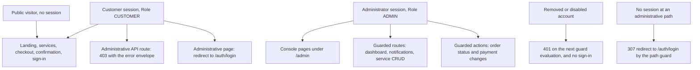

# Crazwash — Product Requirements Document

Product requirements for the Crazwash web application: the ordering and operations app for a shoe and
bag cleaning business in Bandung, Indonesia.

This PRD describes the release currently in the working tree. It states plainly which requirements the
code satisfies, which satisfy them only as a code reading that no database-backed deployment has
exercised, and which are not implemented at all.

Last verified against: branch `fix/auth-guards`, latest commit subject
`Merge pull request #2 from athallaarl66/fix/customer-face` (HEAD `84cd51f`), with the authentication
and administrative-guard work present as uncommitted working-tree changes and no database-backed run
performed in this checkout (no `.env`; only `.env.example`). Verified 2026-10-13.

Companion documents:

- `docs/projects/crazwash-technical-documentation.md` — the technical reference for the same release.
- `README.md` — setup and the security values.
- `docs/issues/issue-01-customer-facing-placeholders.md` and
  `docs/issues/issue-02-auth-and-admin-authorization.md` — the two resolved issues, with the checks
  still pending.
- `openspec/changes/` — the changes that carry the remaining work, and therefore the acceptance
  detail behind section 10.

---

## 1. Summary and background

Crazwash is a small shoe and bag cleaning service in Bandung. Customers hand over shoes or bags,
the shop cleans them, and the customer collects them or has them delivered.

**How the business ran before the app.** Orders arrived over WhatsApp or by phone. Prices were
quoted from memory or from a picture of a price list, pickup times were agreed in chat, payment was a
bank transfer or cash with the proof sent as a chat image, and the record of what was owed and what
had already been paid lived in the chat thread and in the owner's head. Three concrete problems
followed:

- **No single record of an order.** A conversation could not answer "how many orders are in the shop
  right now" or "which ones are paid".
- **Published prices drifted.** The price list existed in more than one place, so a price change
  reached some customers and not others.
- **Payment state was guesswork.** Proof of transfer sat in a chat, unconnected to any order record,
  so "paid" was something someone remembered.

**What the app is.** A web application with two faces. A public face where a customer sees the
current prices, places an order, schedules a pickup, chooses a payment method, and receives an order
number. An administrative face where the operator triages those orders, moves them through the
cleaning process, marks payment, maintains the service catalogue, looks up customers, and reads
revenue and volume figures.

**How payment works, deliberately.** There is no payment gateway and no in-app payment-proof upload.
Customers pay by bank transfer, e-wallet, QRIS or cash on delivery, then send the proof over WhatsApp
to the business number. That decision is recorded in
`openspec/changes/fix-customer-facing-placeholders/proposal.md` and is treated in this document as a
product boundary, not a gap.

**What changed most recently.** Two problems dominated the last cycle. Developer placeholder data
(a fabricated WhatsApp number, invented bank accounts, a price list copied into page code) was
reaching customers; and the administrative surfaces had authorization that could never reject anyone,
because the session role was hardcoded to administrator. Both were replaced: customer-facing business
values now come from configuration, and authorization is decided from the stored account record on
every request.

---

## 2. Goals and non-goals for the current release

**Goals.**

1. A customer can find the real current prices, place an order, book a pickup, and get an order
   number, without an account and without talking to a person first.
2. Every customer-facing business value (the WhatsApp number that receives proof, the payment
   destinations and their account details) comes from configuration. The application cannot display
   an invented account or an example phone number.
3. The published price list is the catalogue. One price change by the operator changes what customers
   see, with no code change.
4. Only a genuine, currently-enabled administrator account can read or change administrative data,
   and that decision is taken from the stored account record rather than from what the session
   remembered at sign-in.
5. Public order creation and sign-in both have abuse limits that hold across serverless instances.
6. The operator can see revenue, order volume and customer figures for a chosen period, and can
   manage orders and the service catalogue from one console.
7. The state of the release is honest: this document and the technical documentation distinguish what
   has been exercised from what has only been read.

**Non-goals for this release.**

- Online payment. No gateway, no proof upload, no reconciliation.
- Multi-factor authentication, and any role beyond administrator and customer.
- Rewriting the console's visual design, or fixing the console's reporting and status-model defects
  (that is the planned `fix-admin-console-ux` change, section 10).
- Providing a formal test-coverage target or CI gate in this release. The suite exists and passes;
  there is no pipeline enforcing it yet.

---

## 3. Personas and roles

Two roles exist in the product, matching the `Role` enum in `prisma/schema.prisma`: `CUSTOMER` and
`ADMIN`. There is no self-service customer account, no staff role, and no user-management screen.

### 3.1 Customer (anonymous visitor, and sometimes a `CUSTOMER` record)

Typical person: someone who owns shoes or a bag, lives in or near Bandung, found the shop through
social media or word of mouth, and wants to know the price and get the item cleaned without a long
conversation.

Jobs to be done:

- Find out what a cleaning costs, in rupiah, without asking anyone. (Pickup and delivery may be free
  only in certain areas, so the price list is the entry point.)
- Order the service without creating an account or remembering a password.
- Choose a pickup date that suits them and leave a note about the item, its material or its damage.
- Know where to send the money and what to send as proof, in the same place they ordered.
- Get something to quote so the shop can find the order: an order number.
- Know what happens next without chasing the shop.

What they do **not** need from this release: an account they can sign in to, an order-tracking
dashboard, or an in-app upload for the transfer proof. The record created from their details cannot
sign in by design; the shop sets a credential only when there is a reason to.

### 3.2 Shop administrator / operator (`Role.ADMIN`)

Typical person: the owner or a trusted family member running the shop, often from a phone, between
handling physical items.

Jobs to be done:

- See what came in, and what is waiting on the shop rather than on the customer (unpaid, unconfirmed,
  ready for pickup).
- Confirm an order, and mark payment received once the transfer lands or the cash is taken.
- Move an order through the physical process and see its status at a glance.
- Get the details needed to actually do the job: address, pickup date, phone number, notes.
- Keep the catalogue correct: add a service, change a price, retire a service that is no longer
  offered (without losing the orders that already reference it).
- Find a customer by phone or name and see what they have ordered and spent.
- Read how the business is doing for a period, in revenue and in volume.

Constraints that matter to them: the console is used on a phone as much as on a laptop; a wrong
figure is worse than a missing one; and every extra tap on a repeated daily task is a real cost.

### 3.3 Role and permission view

Read it as: the public surface is open to everyone; the administrative surface requires an account
that is `ADMIN`, not removed and not disabled at the moment of the request; and the path guard alone
is never enough, because it can only see that a session exists.

---

## 4. User journeys

Journeys are numbered. Where a step depends on a value the business must configure, that is stated.

### 4.1 Browsing prices

1. The customer opens the landing page. The page renders the price list grouped by service category
   (basic, premium, deep cleaning, treatment), each service with its name, optional badge and price
   in rupiah, formatted for Indonesian readers.
2. Prices come from the catalogue the operator maintains. If the operator changes a price, the next
   visitor to load the page sees the new price; nothing is cached into page copy.
3. If the catalogue is empty, the page says the service list is not available and asks the customer to
   contact the shop, rather than showing a stale or sample list.
4. The customer can open the dedicated services page for the same catalogue, with each service's
   description.
5. From either page, the customer can start an order.

### 4.2 Placing an order

1. The customer opens the order page. If the catalogue is empty, the page reports a load failure and
   offers a reload; if no payment destination is configured, the page says payment is not available
   yet and refuses to show a form. **This means the business must configure at least one payment
   destination before customers can order at all.**
2. Step 1: the customer selects one or more services and the quantity of items for each. The running
   total is shown.
3. Step 2: the customer enters name, phone number, an optional email, and the pickup address. Without
   name, phone and address the step cannot be completed.
4. Step 3: the customer picks a pickup date and may add notes about the items.
5. Step 4: the customer chooses from the configured payment destinations only. The destination shows
   what the customer needs to pay: account label, number and holder for a transfer or e-wallet, a QR
   image for QRIS, or an instruction for cash on delivery.
6. The customer submits. The server recomputes every price and the total from the stored catalogue —
   the amount the browser sent is not trusted — links or creates the customer record, and stores the
   order as waiting for confirmation and unpaid.
7. On success the customer is taken to the confirmation page carrying only the order number.
8. If the customer has submitted five orders from the same device within the hour, the submission is
   refused with a message asking them to try later or contact the shop, and no order is stored.

### 4.3 Paying and sending proof

1. On the confirmation page the customer sees the order number, their name, the total, the chosen
   payment method as the business named it, and a link to the business WhatsApp number.
2. The customer leaves the app and pays: transfers to the account shown, scans the QR, or pays cash
   when collecting.
3. The customer sends the proof of payment (transfer screenshot, QRIS receipt) to the business
   WhatsApp number, quoting the order number.
4. The application records nothing about the proof itself. Nothing writes the `paymentProof` field,
   and there is no upload control. The order stays unpaid until an operator marks it paid after
   checking WhatsApp.

### 4.4 Seeing the confirmation

1. The customer opens the confirmation page with the order number, immediately after ordering or
   later from the link they kept.
2. The page reads the stored order and shows the stored values. Refreshing, or opening it on another
   device, shows the same order; editing the URL cannot fabricate a success state.
3. If the order number is wrong, unknown or malformed, the page shows an explicit "order not found"
   state and never a success heading.
4. Anyone who knows an order number can read that confirmation. This is accepted for this release and
   listed as a risk in section 9.

### 4.5 Administrator triaging and updating an order

1. The operator opens the console and signs in with an account that is enabled, not removed, and has
   the administrator role. A customer-role account or a removed account cannot sign in; five failed
   attempts lock the account for fifteen minutes.
2. The orders list shows the orders with their status and payment state, and offers search and
   filters.
3. The operator opens an order. Today the detail view shows the order number, both statuses, the
   customer name and email, the service lines and the total. It does **not** yet show the pickup
   address, pickup date, phone number, payment method or the customer's notes, which the operator
   needs to fulfil the order; that is the planned `fix-admin-console-ux` change.
4. The operator confirms the order, then marks it paid once the payment is verified. Marking payment
   does not change the status; the two are separate controls.
5. The operator selects the next status as the items move through the shop. Two stored statuses,
   picked up and in progress, cannot be selected from this control: the control collapses them into
   "ready". A failed change currently looks like a successful one, because the console discards the
   result of the action; both defects are owned by the planned `fix-admin-console-ux` change.
6. The operator can add status changes by the same route, and completing an order from the console
   does not, today, record a completion date.

### 4.6 Managing the service catalogue

1. The operator opens the catalogue and sees all services that have not been deleted, with prices and
   active state.
2. Creating a service takes a name, price, category, duration and active state; the name becomes the
   service's URL slug.
3. Editing a service changes any of those; renaming regenerates the slug.
4. Deleting a service is a soft delete: it disappears from the catalogue, the console list and the
   public pages, but the orders that already reference it keep their price snapshot and stay intact.
5. The operator can delete several selected services at once. The console currently refreshes as if
   the bulk delete succeeded without checking the response, so a failed bulk delete can look
   successful; owned by `fix-admin-console-ux`.

### 4.7 Monitoring revenue

1. The operator opens the dashboard and picks a period (7 days, 30, 90, six months or a year).
2. The dashboard reports paid revenue for the period with the growth against the previous period of
   the same length, the count of paid orders with its growth, the number of items cleaned, the count
   of active customers, and the average order value.
3. It also reports what needs attention: orders awaiting confirmation, orders marked unpaid that have
   a payment proof on record (permanently zero today, because nothing writes that field), orders
   ready for collection, and pickups scheduled for today.
4. Today's activity is reported separately: new orders, orders in progress with their item count,
   orders completed, and pickups needed.
5. Revenue is broken down by payment state, by service category, and as a trend over the period; the
   top five services by revenue are listed with their item counts and order counts.
6. Only orders recorded as paid count towards revenue. If the dashboard's query fails, it answers with
   the same shape filled with zeros rather than an error, so an outage looks like an empty period.
7. Nothing on the dashboard is reconciled against a payment provider; every figure is the
   application's own record.

### 4.8 Customer journey overview

```mermaid
flowchart LR
  J1["Read the price list on /"] --> J2["Choose services on the order page"]
  J2 --> J3["Enter name, phone, address"]
  J3 --> J4["Choose a pickup date"]
  J4 --> J5["Choose a configured payment method"]
  J5 --> J6["Submit: the server recomputes the total"]
  J6 --> J7["Confirmation page shows the stored order"]
  J7 --> J8["Pay outside the app and send proof on WhatsApp"]
  J8 --> J9["Operator confirms and marks paid"]
  J9 --> J10["Operator tracks the item until completed"]
```

---

## 5. Functional requirements

Status vocabulary used below:

- **implemented** — the behaviour is present in the code and is covered by an offline check (type
  check, unit test or existing test suite) or by a purely static property that a database cannot
  change.
- **implemented but unverified** — the code is present, but confirming the behaviour needs a running,
  database-backed deployment, which this checkout cannot provide (no `.env`). Every such requirement
  is a code reading, not an observation.
- **not implemented** — the code does not do this.

| ID | Requirement | Priority | Status | Implemented by |
| -- | ----------- | -------- | ------ | -------------- |
| FR-01 | The landing page publishes prices read from the service catalogue, grouped by category, formatted in rupiah, with no hardcoded price list. | must | implemented but unverified | `app/page.tsx`, `lib/productService.ts`, `lib/constants.ts` |
| FR-02 | A public services page lists the same catalogue with descriptions. | must | implemented but unverified | `app/(public)/services/page.tsx` |
| FR-03 | A customer can place an order without an account by choosing services and quantities, giving name, phone, optional email and address, choosing a pickup date, adding notes and choosing a payment method. | must | implemented but unverified | `app/(public)/order/page.tsx`, `app/(public)/order/components/OrderForm.tsx`, `actions/orderActions.ts` |
| FR-04 | The server recomputes unit prices, subtotals and the order total from the stored catalogue, stores the price as a snapshot on each order line, and rejects an order that references an inactive or deleted service. | must | implemented but unverified | `actions/orderActions.ts`, `prisma/schema.prisma` (`OrderService.unitPrice`) |
| FR-05 | Payment instructions come only from configuration: the checkout shows the configured destinations, maps each method to its own instructions, and shows an operational error instead of a method list when nothing is configured. | must | implemented | `lib/business-config.ts`, `app/(public)/order/components/steps/Step4Payment.tsx`, `tests/payment-step.test.tsx`, `tests/business-config.test.ts` |
| FR-06 | The confirmation page resolves the order from storage by order number, shows the stored values, and shows a not-found state for an unknown or malformed number. | must | implemented but unverified | `app/(public)/order/success/page.tsx`, `app/(public)/order/success/SuccessClient.tsx`, `tests/success-view.test.tsx` |
| FR-07 | Checkout links an existing customer record by phone and then by email without changing its role, name, address or last sign-in, and otherwise creates a record whose stored credential is a hash of an undisclosed random secret, so it cannot sign in. | must | implemented but unverified | `actions/orderActions.ts`, `prisma/migrations/20261013134707_user_email_nullable` |
| FR-08 | An administrator signs in with an email and password; a missing, disabled or removed account is refused with the same result as a wrong password, and a successful sign-in clears the counters and records the sign-in time. | must | implemented but unverified | `lib/auth.ts`, `app/auth/login/` |
| FR-09 | Every administrative route handler and every administrative server action authorizes from the stored account record — role, enabled state and removal state — before doing any work, answering 401 for an unusable account and 403 for the wrong role. | must | implemented but unverified | `lib/api-error-handler.ts`, all handlers under `app/api/admin/`, `app/api/orders/[id]/route.ts`, `app/admin/orders/action.ts`, `actions/orderActions.ts`, `tests/security-policy.test.ts` (asserts the guard is called) |
| FR-10 | An administrator can change an order's status from the console, restricted to the transitions the console offers. | must | implemented but unverified | `app/admin/orders/components/OrderStatusBadge.tsx`, `app/admin/orders/action.ts` |
| FR-11 | An administrator can mark an order paid or unpaid independently of its status. | must | implemented but unverified | `app/admin/orders/components/PaymentStatusBadge.tsx`, `app/admin/orders/action.ts` |
| FR-12 | An administrator can create, read, update and soft delete a service; a deleted service disappears from the catalogue and the public pages while existing orders keep their snapshot. | must | implemented but unverified | `app/api/admin/service/route.ts`, `app/api/admin/service/[id]/route.ts`, `lib/productService.ts` |
| FR-13 | An administrator can soft delete several selected services in one request. | should | implemented but unverified | `app/api/admin/service/bulk-delete/route.ts`, `app/admin/service/ProductsTable.tsx` |
| FR-14 | An administrator can see a customer list with order counts, spending and a recency status, and a per-customer view with that customer's order history. | should | implemented but unverified | `lib/customerService.ts`, `app/admin/customers/page.tsx`, `app/admin/customers/[phone]/page.tsx` |
| FR-15 | The dashboard reports paid revenue with growth, paid order count with growth, items cleaned, active customers, average order value, attention counts, today's activity, revenue breakdowns by payment state and category, a revenue trend, a status distribution and the top five services, for a selectable period. | must | implemented but unverified | `app/api/admin/dashboard/route.ts`, `app/admin/dashboard/page.tsx` |
| FR-16 | The console notifies an administrator when an order arrives. | should | not implemented | Nothing writes a `Notification` row; `app/api/admin/notifications/route.ts` can only read, mark one read or mark all read, so the bell is permanently empty. Planned in `openspec/changes/fix-admin-console-ux` group 5, which also allows removing the feature |
| FR-17 | An administrator can export the customer list, or one customer's orders, as CSV or JSON. | could | implemented | `components/ui/export-button.tsx`, used by `app/admin/customers/page.tsx` and `app/admin/customers/[phone]/page.tsx`; the export happens in the browser from data already loaded |
| FR-18 | Public order creation is limited to five submissions per client per hour, enforced before anything is stored, using storage shared across instances. | must | implemented but unverified | `lib/rate-limit.ts`, `actions/orderActions.ts`, `prisma/migrations/20261013134800_add_rate_limit`, `tests/security-policy.test.ts` (asserts the values) |
| FR-19 | Failed sign-in attempts are limited: five failures lock the account for fifteen minutes, within which even the correct password is refused. | must | implemented but unverified | `lib/auth.ts`, `tests/security-policy.test.ts` (asserts the values) |

Notes that belong to the requirements rather than to a single cell:

- FR-01, FR-02, FR-03, FR-06, FR-12, FR-14 and FR-15 are marked unverified because their behaviour
  depends on stored data that this checkout cannot provide. Their code paths pass the type check, and
  the parts that do not need a database (configuration parsing, the payment step's rendering rules,
  the confirmation view's refusal to show a success state without an order) are covered by the 20
  passing tests.
- FR-09, FR-18 and FR-19 are asserted only structurally offline: the tests check that the guard is
  called and that the documented limits match the constants. No request has been served.
- FR-10 is satisfied with a known gap: two of the seven stored statuses (`PICKED_UP`,
  `IN_PROGRESS`) cannot be displayed or selected from the console's status control.
- FR-16 is the one requirement in this table that the product does not deliver; the `README.md`
  feature list no longer advertises real-time notifications, and the capability still has no writer.
- FR-17 is implemented as a browser-side export of data already loaded into the page. There is no
  server-side export endpoint, and the audit-log export helper in `lib/audit.ts` is never called.

---

## 6. Non-functional requirements

**Security.**

- Authorization is decided from stored state on every administrative call: role, enabled state and
  removal state are read from the account row, so a demotion, disable or removal takes effect on the
  next request instead of at token expiry.
- No shared credential: no customer-facing flow writes a credential a person could know. Records
  created by checkout carry a hash of a random secret that is never disclosed, and no substitute email
  address is invented for a customer who gave none.
- Abuse limits: a database-backed counter limits public order creation to five per client per hour,
  and an account lockout of five failed sign-in attempts per fifteen minutes protects credentials.
- Configuration over placeholder data: customer-facing payment and contact values come from the
  environment, the code contains no fallback account, and the build fails when a required value is
  missing.
- Secret handling: one environment secret signs session tokens; the repository contains no secret
  value, and the deployment must rotate that secret because sessions issued before the authorization
  change carry a role that was hardcoded.
- Documentation of the guard: the security section of `README.md` documents the lockout, the order
  limit, the path guard and the two manual checks, and an offline test asserts that the documented
  numbers match the code.

**Performance.**

- Lookups used for the hot paths are indexed: order number, order status, order customer, product
  active state, product category, product sort order, notification recipient/read/created time, and
  the rate-limit key as a primary key.
- The dashboard computes each figure with its own aggregate or grouped query rather than loading rows
  into the application, except the revenue trend, the category breakdown and the top services, which
  read the service lines for the period and aggregate in memory. There is no caching layer, so each
  dashboard load re-queries.
- Order creation is a small fixed number of queries: rate limit, customer lookup (up to two), product
  lookup, order insert with its lines.
- No page paginates the customer list: it loads every customer with their orders and filters in the
  browser. This is a known scaling limit, deliberately out of scope of the console change.
- No performance test exists, and no figure for response time is claimed.

**Data integrity.**

- Money is `Decimal(10,2)` in the database, and each order line keeps the unit price and subtotal as a
  snapshot taken at creation.
- The total an order stores is recomputed on the server from stored prices; a client cannot set it.
- Deletion is soft for customers and services, so references from historical orders remain valid.
- Uniqueness is enforced by the database: order number, product slug, user email, session token,
  verification token, the provider/account pair, and one service line per order and product.
- Orders and their service lines are written in a single nested insert; deleting an order cascades to
  its lines.
- There is no transaction around the customer link-or-create step and the order insert: a failure
  there logs and still creates the order without a customer link, by design, so an order is never lost
  to a customer-record problem.

**Accessibility and localization.**

- The customer-facing interface is in Indonesian, including validation and refusal messages a customer
  can read ("Nama, nomor HP, dan alamat wajib diisi", "Terlalu banyak pesanan dari perangkat ini").
- Currency is formatted with the Indonesian locale and currency (`Intl.NumberFormat("id-ID")`, IDR, no
  decimals); dates are formatted for Indonesian readers.
- The console uses labelled controls and a shared component set (Radix-based), styled for both narrow
  and wide screens, which matters because operators use phones.
- No formal accessibility audit has been run and no conformance claim is made. The interface language
  is not configurable.

**Observability.**

- What exists: server-side `console.error` on API failures, on guard refusals through the shared error
  handler, and on configuration failures; the error envelope returns a machine-readable `code` and an
  ISO timestamp with every failure; the build-time configuration gate prints what it checked.
- What does not exist: no audit-log writer (the audit module and its table are unused), no request or
  latency logging, no error tracking service, no alerting, no structured logs, and no health endpoint.
  A dashboard query failure is logged and then answered as zeros, so monitoring cannot distinguish a
  quiet week from a broken query without reading the logs.
- Debug logging currently prints customer name, phone, email and address during order creation; its
  removal is task 8.1 of `openspec/changes/remove-dead-code-and-slop`.

---

## 7. Out of scope

- **Online payment gateway.** No Midtrans/Xendit/QRIS API integration. Customers pay manually outside
  the app and send proof over WhatsApp. Recorded in
  `openspec/changes/fix-customer-facing-placeholders/proposal.md`.
- **In-app payment-proof upload.** Nothing writes the order's payment-proof field, and there is no
  upload control. The manual WhatsApp handoff is the process.
- **Multi-factor authentication.** Deliberately absent: migration `20260203041612_remove_mfa` removed a
  previous implementation, and the change that hardened sign-in left MFA out of scope.
- **Roles beyond administrator and customer.** `Role` has exactly two values. There is no staff role,
  no super-admin, and no self-service customer sign-in.
- **A user-management UI.** Accounts are created by checkout or by the seed script; roles are changed
  in the database. There is no screen for creating, disabling or promoting an account.
- **An admin UI for payment destinations.** Configuration stays an environment change with a
  redeploy; the recorded upgrade path is to move the same shape behind a table and keep the
  configuration module as its read API.
- **Customer list pagination, audit-log viewing, and new console features generally.** Explicitly out
  of scope of the two remaining changes.

---

## 8. Success measures

**What the dashboard reports today (paid orders only).**

| Measure | Definition in the application |
| ------- | ----------------------------- |
| Paid revenue | Sum of `totalPrice` for orders created in the selected period with payment status paid |
| Revenue growth | The period's revenue against the immediately preceding period of the same length |
| Paid orders | Count of orders in the period with payment status paid, with the same growth comparison |
| Items cleaned | Sum of item quantities on the service lines of those paid orders |
| Active customers | Distinct customer phone numbers with a non-cancelled order in the period |
| Average order value | Paid revenue divided by paid order count |
| Customer mix | Distinct customers in the period, split into one-order and repeat customers |
| Needs attention | Orders awaiting confirmation; unpaid orders with a proof on record; orders ready; pickups scheduled today |
| Today | New orders, orders in progress with item counts, orders completed today, pickups needed |
| Breakdowns | Revenue by payment state, revenue by service category, revenue trend, status distribution, top five services by revenue |

**What would show the hardening worked.** These are the acceptance signals for the changes already in
the tree, and each is currently pending because no database-backed run has happened:

- Zero unauthorized administrative responses: an anonymous caller and a customer-role caller each get
  an authorization error with no business data from every administrative route and action, and a
  customer-role session is redirected away from every administrative page.
- No placeholder business data visible anywhere: no example bank account, no example phone number, and
  no price list that disagrees with the catalogue, on any customer-facing page.
- A role changed in storage takes effect on the next request, not at token expiry.
- The order limit refuses the sixth submission in an hour without storing an order, and the fifth
  failed sign-in attempt locks the account for the window, including against the correct password.
- Checkout creates a customer record that cannot sign in, and links an existing record without
  changing its role, name or address.

**What would show the product is being used as intended.** Not currently instrumented, and stated
here so a reader does not mistake the dashboard for usage analytics: order volume and paid revenue per
week, the share of orders that reach completed, and the time between order creation and completion.
The data to derive them exists on the order record; nothing computes or exposes it today.

---

## 9. Risks and mitigations

| Risk | Why it matters | Mitigation today | Where it is recorded |
| ---- | -------------- | ---------------- | -------------------- |
| Order numbers are guessable, and the confirmation page is readable by anyone who knows one | Anyone can read a customer's name, total and payment method from `/order/success` by trying numbers; the number carries a timestamp and a three-digit random suffix | Accepted risk, stated in the design of the customer-facing change. The follow-up is a second factor (phone suffix or a signed link) in its own change. Until then the exposure is limited to the order summary, not to payment data | `openspec/changes/fix-customer-facing-placeholders/design.md`, and section 12 of the technical documentation |
| Lockout can be turned against a legitimate owner | Five wrong passwords lock an account for fifteen minutes, so anyone who knows the email can deny the owner access repeatedly | The lock is time-boxed, the account is not disabled, and `README.md` documents the exact SQL that clears it. A longer window and a per-account alert are not implemented | `README.md` ("Sign-in lockout"), section 11.1 of the technical documentation |
| One shared signing secret | A leaked `NEXTAUTH_SECRET` lets an attacker mint a valid session; it is also the one value that must be rotated because older sessions carry a hardcoded role | The secret lives only in the environment, is never committed, and rotation invalidates every session at once. There is no key rotation schedule and no automatic rotation | `README.md` (Notes), the migration plan of `openspec/changes/harden-auth-and-admin-guards` |
| Behaviour in this checkout is unverified against a database | The two migrations, the guard on real accounts, the lockout, the order limit and every dashboard figure are code readings only | The pending-check lists in the two issue documents name the exact request, SQL or walkthrough that closes each one, and the technical documentation lists the commands | `docs/issues/issue-01-*.md`, `docs/issues/issue-02-*.md`, section 13 of the technical documentation |
| A customer-visible failure looks like an empty period | The dashboard answers with zeros when its query fails, so a broken deployment is indistinguishable from a quiet week on the console | Errors are logged server-side; the console shows no warning | Technical documentation, sections 6.5 and 12 |
| Configuration is a redeploy | Payment destinations and the WhatsApp number are environment values; a changed bank account needs a redeploy, and a missing value blocks ordering entirely | The build-time gate fails the deployment rather than shipping placeholders, and the checkout refuses to render a payment step it cannot fill. The recorded upgrade path is a table plus an admin screen | `openspec/changes/fix-customer-facing-placeholders/design.md` |
| Two order-creation paths and two status-update paths exist | An unused API route writes orders with a different number format and no customer link; an unused status path is the only one that records a status history. A future caller could pick the wrong one | Both are named in the removal and console changes; neither is reachable from the UI today | `openspec/changes/remove-dead-code-and-slop` tasks 2.1, 3.3, 3.4; `fix-admin-console-ux` group 1 and 2 |
| Dependency vulnerabilities are unaddressed | The dependency set is broad for the size of the product and includes packages no longer used | Nothing automated runs currently; `npm audit` is a recorded follow-up rather than a gate | `openspec/changes/remove-dead-code-and-slop` (dependency removal), section 10 below |

---

## 10. Release plan and backlog

**Where the release stands.** The two applied changes are in the working tree: the customer-facing
placeholder replacement is merged, and the authorization hardening is uncommitted with 4 of its 21
tasks ticked (the tasks whose stated verification is offline). Task counts below are the output of
`openspec list` at the time of writing.

| Change | Tasks | State |
| ------ | ----- | ----- |
| `harden-auth-and-admin-guards` | 4/21 | Implemented in the working tree, uncommitted; 17 verification tasks pending a database-backed run |
| `fix-customer-facing-placeholders` | 8/14 | Merged; 6 verification tasks pending a database-backed run |
| `remove-dead-code-and-slop` | 0/23 | Planned, not started |
| `fix-admin-console-ux` | 0/23 | Planned, not started; must be applied after the auth change so the action guards are already in place |

**Next: `remove-dead-code-and-slop` (23 tasks, not started).** The repository carries code,
documentation and configuration that nothing uses or that no longer matches the implementation, and
no gate catches the drift. The change removes unused runtime dependencies (`swiper`, `otplib`,
`qrcode`, `resend`), unused UI components, dead exports and modules (including the hook that targets a
route that does not exist and the page file that imports itself), and the three order-creation paths
are reduced to one. It consolidates the duplicated product type declarations, the four currency
formatters and the three order-number generators, and corrects the in-repo READMEs that describe
behaviour the code does not have. It also ends the dead dark-mode configuration, re-encodes six
committed photographs that account for roughly 31 MB, strips the generation marker comments and debug
logging, and adds the missing quality gate: a CI workflow running install, type check, lint and tests,
plus a minimal test setup. It changes no system behaviour and deliberately opts out of spec deltas.

**Then: `fix-admin-console-ux` (23 tasks, not started).** The console shows operators a partial and in
places wrong picture of their own business, so it cannot be trusted for daily work. The change makes
every one of the seven stored order statuses visible and selectable (the console currently exposes
five and silently rewrites two, so picked-up and in-progress orders display as ready); completes the
order detail view with the pickup address, pickup date, phone number, payment method, customer notes,
internal notes, payment-proof reference and status history an operator needs to fulfil an order;
surfaces the result of status and payment changes through the toast component already mounted instead
of discarding it; corrects the orders page summary figures, which currently describe only the ten rows
on screen rather than the filtered result set; gives the notification feature a writer and a refresh
path, or removes it from the console and the documentation; fixes navigation that leads nowhere (the
header search route does not exist, and an expired session on the service list redirects to an API
endpoint instead of the sign-in page); and makes the service duration unit unambiguous, since the same
value is labelled as days in two surfaces and as hours in two others.

**Recurring follow-ups already recorded.**

1. **Order-number second factor.** The confirmation page is readable by anyone who can guess a number.
   The recorded follow-up is a phone suffix or a signed link, in its own change
   (`fix-customer-facing-placeholders/design.md`).
2. **Admin UI for payment destinations.** The recorded upgrade path of the configuration module: move
   the same typed shape behind a table and keep `lib/business-config.ts` as the read API, so a changed
   account no longer needs a redeploy.
3. **Dependency vulnerabilities reported by `npm audit`.** No automated audit gate exists; the removal
   change trims the dependency set, and auditing the remainder is a recurring task rather than a
   one-off.
4. **Customer list pagination.** Explicitly deferred and unowned: the list currently loads every
   customer with their orders and filters in the browser.
5. **Notification retention.** If the notification feature is kept, the console change requires a
   documented retention decision so the table cannot grow without bound.

**Definition of done for this release.** The two applied changes are committed; both migrations are
applied to a real database; the pending checks listed in the two issue documents have been run and
recorded; the session secret has been rotated in the deployment target; and the console status model
defect is either fixed or explicitly accepted in writing, because as it stands the console reports
fewer statuses than the data model stores.

---

## 11. Open questions

1. **Should the console expose picked-up and in-progress?** The data model has seven statuses and the
   shop's real process may have fewer steps. Either the console is corrected to show all seven, or the
   model is reduced. `fix-admin-console-ux` task 1.3 assumes the first; the business has not confirmed
   which is true.
2. **Are cash on delivery and the other payment methods all still offered?** The configuration accepts
   transfer, e-wallet, QRIS and cash on delivery, and any subset can be configured. Which subset the
   shop actually wants visible is a business decision that no document records.
3. **Should customers ever be able to sign in?** Today a customer cannot: checkout-created records
   carry a credential nobody knows, and there is no self-service account. If order tracking for
   customers is wanted, that is a new capability, not a fix.
4. **What happens to a service after it is deleted?** Soft delete keeps historical orders intact and
   hides the service everywhere, but nothing records who deleted it or when the operator should
   instead deactivate it. The distinction between "inactive" and "deleted" is not documented for
   operators.
5. **Who owns the audit trail?** An audit table, an action enum and a writer module exist and are
   unused. Either the writer is wired to order and service changes, or the module and table are
   removed. No change currently owns this.
6. **What is the target for the two pending verification groups?** Two issue documents list 23 checks
   that need a database-backed run. Until someone schedules that run against a seeded environment, the
   same "implemented but unverified" status applies to the next release as well.
