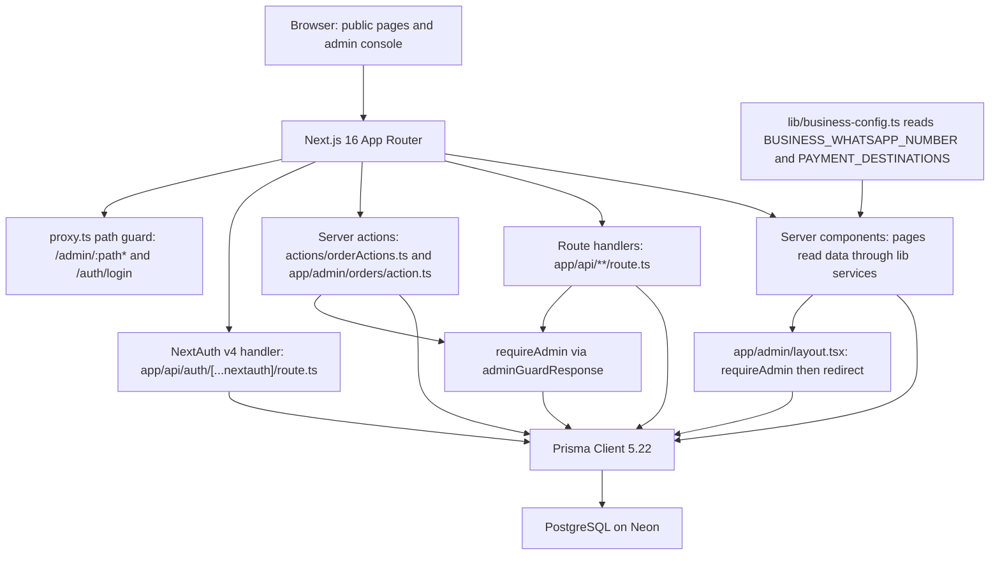
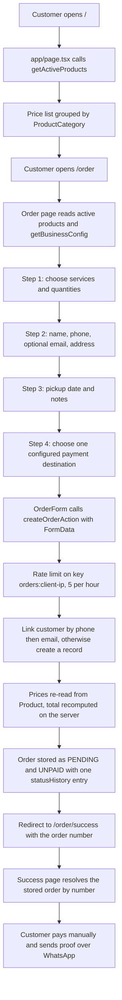
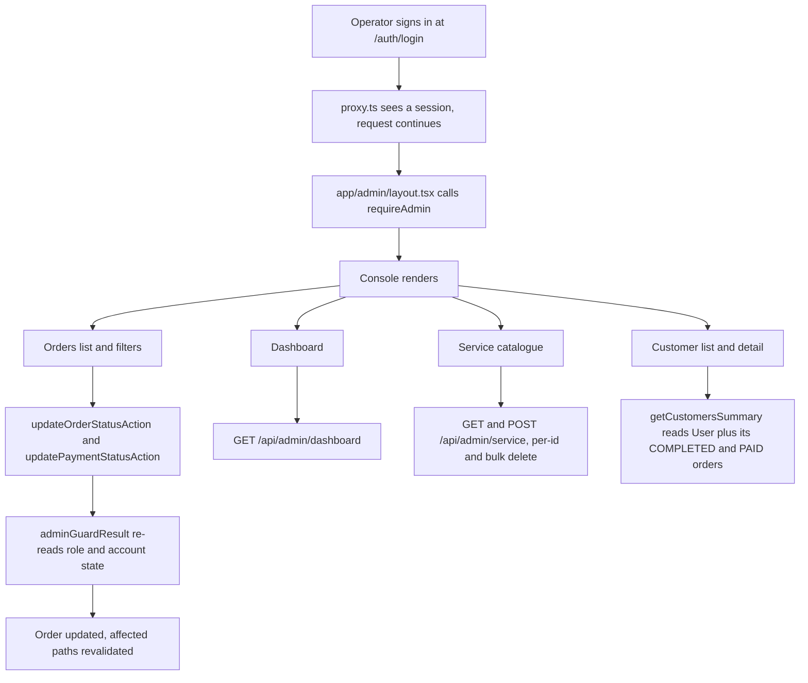
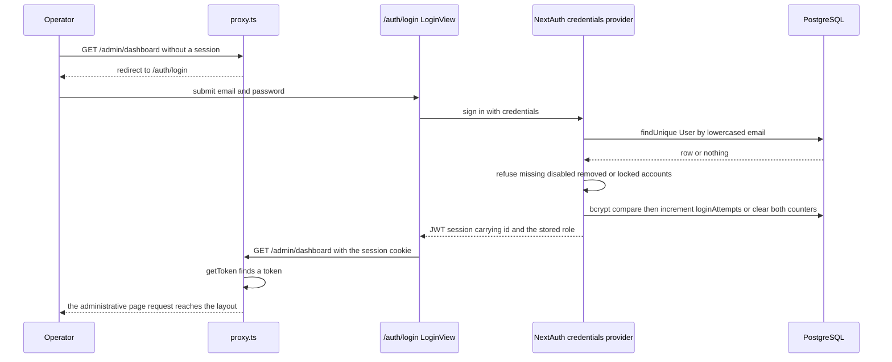
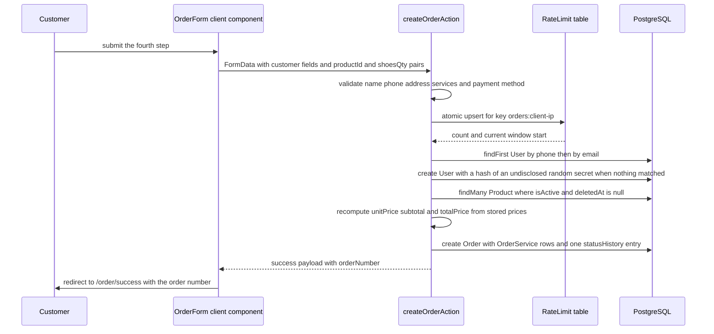
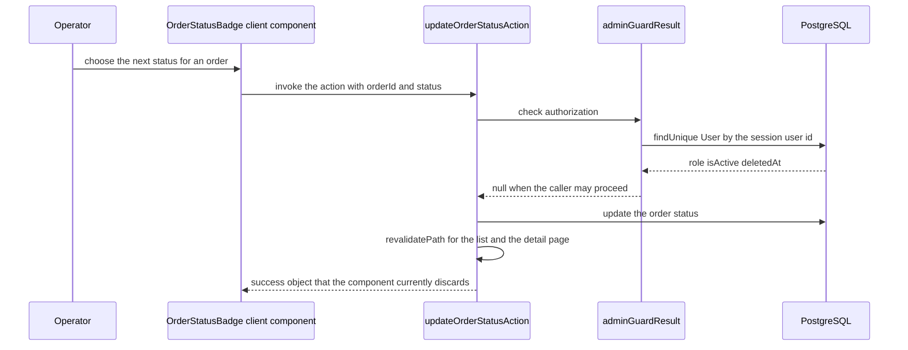
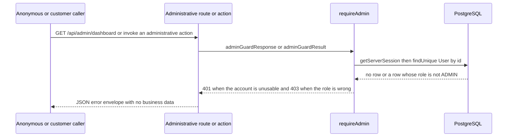
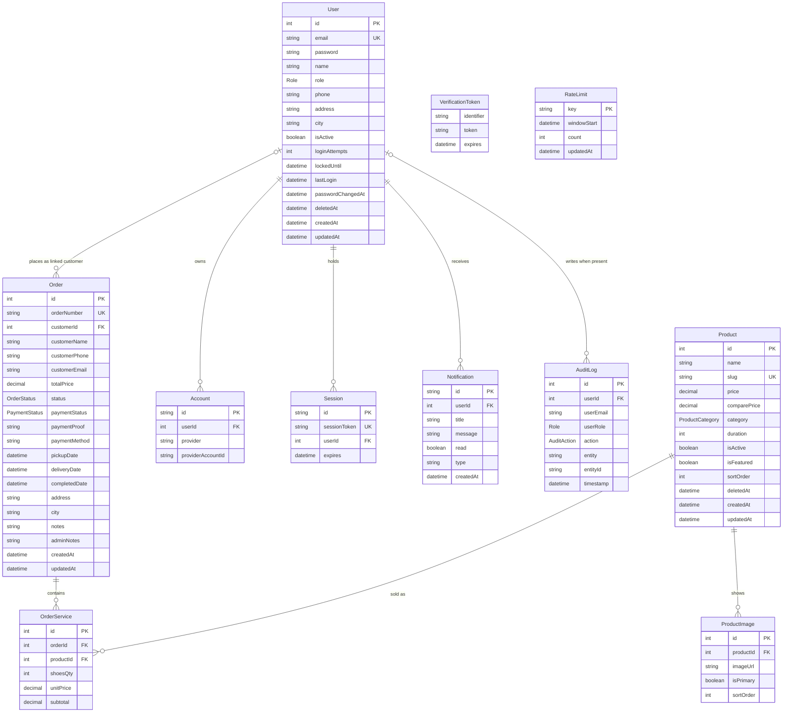

# Crazwash — Technical Documentation

Project-level technical reference for the Crazwash web application: the shoe and bag cleaning
service app for the Bandung business of the same name. Every statement below was read from the code
in the working tree at the time of writing; nothing is described as verified unless the check is
named.

Last verified against: branch `fix/auth-guards`, latest commit subject
`Merge pull request #2 from athallaarl66/fix/customer-face` (HEAD `84cd51f`), with the
authentication and administrative-guard work present as uncommitted working-tree changes and no
database-backed run performed in this checkout (no `.env`; only `.env.example`). Verified
2026-10-13.

Related documents, not repeated here:

- `README.md` — setup, environment variables, and the Security section (lockout, order limit,
  manual guard checks).
- `docs/issues/README.md`, `docs/issues/issue-01-customer-facing-placeholders.md`,
  `docs/issues/issue-02-auth-and-admin-authorization.md` — symptoms, root cause, evidence and
  pending checks for the two resolved issues.
- `openspec/changes/` — the four planned or applied changes with proposals, designs, specs and
  task lists.

---

## 1. Overview

Crazwash is a small shoe and bag cleaning business in Bandung, Indonesia. The application exists to
take the business off ad-hoc WhatsApp bookkeeping and give it one structured record of every order,
a manageable service catalogue, and a console that reports revenue.

Two audiences:

- **Customers** — browse the price list, order a cleaning service, schedule a pickup, choose a
  payment method, and receive an order number to quote when they send payment proof. Payment is
  manual: bank transfer, e-wallet, QRIS, or cash on delivery, then the customer sends proof over
  WhatsApp to the configured business number. There is no payment gateway and no in-app proof
  upload.
- **Shop administrators** — sign in to an administrative console, triage incoming orders, set status
  and payment state, maintain the service catalogue, look up customers with their order history, and
  read revenue and volume KPIs.

End to end, the system does this:

1. The public landing page and the services page read the `Product` table, so the published price
   list is the catalogue and no marketing prices are hardcoded.
2. The checkout collects services, customer details, pickup date and payment method; the server
   action re-reads the stored prices, computes the total, links or creates a customer record, and
   stores an order in `PENDING` / `UNPAID`.
3. The confirmation page resolves the stored order by its number; the customer pays manually and
   sends the proof over WhatsApp.
4. An administrator signs in, sees the order, confirms it, sets it paid, moves it through the
   remaining statuses, and the dashboard reports the resulting revenue and volume.

Two facts shape the whole design and are repeated where relevant: **authorization is decided from
the stored account record on every administrative request**, never from the role cached in the token;
and **all customer-facing business values (WhatsApp number, payment destinations) come from the
environment**, so no fabricated account details can reach a customer.

---

## 2. Stack and runtime

Versions read from `package.json`.

| Area | Choice | Version |
| ---- | ------ | ------- |
| Framework | Next.js App Router | `next ^16.1.6` (the `README.md` tech table still says "Next.js 15"; the installed package is 16.x — see section 12) |
| Language | TypeScript strict (`tsconfig.json`) | `typescript ^5.9.3` |
| UI runtime | React | `react ^19.2.3`, `react-dom ^19.2.3` |
| Database | PostgreSQL (Neon free tier) via Prisma | `prisma` / `@prisma/client` `5.22.0` |
| Auth | NextAuth v4, Credentials provider, JWT session strategy | `next-auth ^4.24.13`, `@next-auth/prisma-adapter ^1.0.7` |
| Passwords | bcrypt hashing | `bcryptjs ^3.0.3` |
| Styling | Tailwind CSS + shadcn/ui (Radix primitives) | `tailwindcss ^3.4.1`, `@radix-ui/*`, `lucide-react ^0.562.0` |
| Charts | Recharts | `recharts ^3.6.0` |
| Validation / misc | Zod, framer-motion, sonner, canvas-confetti, date-fns, clsx + tailwind-merge | see `package.json` |
| Test runner | Node's built-in test runner driven through `tsx` | `tsx ^4.21.0` |
| Hosting | Vercel (`vercel.json`: `npm install`, `npm run build`) | — |
| Type check | `npx tsc --noEmit` | — |
| Lint | ESLint 9 flat config (`eslint.config.mjs`) | `eslint ^9`, `eslint-config-next 16.1.1` |

Runtime notes:

- `prisma/schema.prisma` declares `provider = "postgresql"` and `url = env("DATABASE_URL")`. No
  other database is supported by the schema.
- The Prisma client is a module singleton in `lib/prisma.ts`; the repository configures no
  connection pool.
- Session strategy is `jwt` with `secret: process.env.NEXTAUTH_SECRET` and
  `pages.signIn = "/auth/login"` (`lib/auth.ts`), so no database session is read on a normal
  request even though the `Session` model exists.
- The path guard is `proxy.ts` exporting `proxy`, the convention Next 16 executes; `middleware.ts`
  is deleted and shipping both files is a build error (evidence in
  `docs/issues/issue-02-auth-and-admin-authorization.md`).
- The application is serverless on Vercel, which is why the rate limiter is backed by a database
  table rather than an in-process map (`lib/rate-limit.ts`).

---

## 3. Repository layout

Annotated tree of the directories that carry behaviour. Files not listed are components, styles and
configuration.

```
Crazwash/
├── app/                                # Next.js App Router
│   ├── layout.tsx                       # root layout
│   ├── globals.css                      # design tokens and Tailwind layers
│   ├── page.tsx                         # public landing page: price list from the catalogue
│   ├── (public)/                        # customer-facing route group
│   │   ├── layout.tsx
│   │   ├── services/page.tsx            # public services page (reads the catalogue)
│   │   └── order/
│   │       ├── page.tsx                 # checkout: products + configured payment destinations
│   │       ├── components/              # OrderForm, the four steps, cart, shared pieces
│   │       └── success/
│   │           ├── page.tsx             # server component: resolves the stored order
│   │           └── SuccessClient.tsx    # presentation only
│   ├── auth/login/                      # credentials sign-in form (LoginView)
│   ├── admin/                           # administrative console
│   │   ├── layout.tsx                   # server component: requireAdmin() then redirect
│   │   ├── page.tsx                     # redirects to /admin/dashboard
│   │   ├── dashboard/page.tsx           # client page reading /api/admin/dashboard
│   │   ├── orders/
│   │   │   ├── page.tsx                 # order list with filters
│   │   │   ├── action.ts                # guarded order server actions (the mutation contract)
│   │   │   ├── components/              # OrderStatusBadge, PaymentStatusBadge, tables
│   │   │   └── [id]/                    # order detail (page + OrderDetailView)
│   │   ├── customers/                   # customer list and per-customer detail
│   │   └── service/                     # catalogue: list, new, detail, edit, ProductsTable
│   └── api/                             # route handlers
│       ├── auth/[...nextauth]/route.ts  # NextAuth handler (GET, POST)
│       ├── orders/route.ts              # POST public — UNUSED by the UI
│       ├── orders/[id]/route.ts         # PATCH administrator guard — UNUSED by the UI
│       ├── service_get/route.ts         # GET public — UNUSED by the UI
│       └── admin/                       # all guarded
│           ├── dashboard/route.ts       # KPI payload
│           ├── notifications/route.ts   # GET, POST
│           └── service/                 # list/create, per-id read/update/delete, bulk delete
├── actions/
│   └── orderActions.ts                  # createOrderAction (public, rate limited) + updateOrderStatus
├── lib/
│   ├── auth.ts                          # NextAuth options, lockout constants, authorize()
│   ├── api-error-handler.ts             # error envelope, withErrorHandler, requireAdmin, guard adapters
│   ├── rate-limit.ts                    # ORDER_RATE_LIMIT, clientIdentifier, atomic upsert
│   ├── business-config.ts               # BUSINESS_WHATSAPP_NUMBER + PAYMENT_DESTINATIONS parsing
│   ├── prisma.ts                        # Prisma client singleton
│   ├── orderService.ts                  # order queries, serializers, admin paging, status update
│   ├── productService.ts                # catalogue queries, create/update, soft delete, bulk delete
│   ├── customerService.ts               # customer summary/detail derived from User + Order
│   ├── audit.ts                         # audit-log writer — present, never imported
│   ├── api-client.ts                    # fetch wrapper
│   ├── constants.ts                     # labels, colours and options derived from the Prisma enums
│   └── utils.ts                         # cn, formatCurrency, formatDate, generateOrderNumber
├── prisma/
│   ├── schema.prisma                    # 11 models, 5 enums
│   ├── migrations/                      # 10 migrations; the two newest add the auth changes
│   ├── seed.ts                          # seed data (admin account, services, sample orders)
│   └── README.md                        # stale in-repo note (see section 12)
├── scripts/
│   ├── check-business-config.ts         # build-time gate for the business configuration
│   └── generate-admin.js                # admin credential generation helper
├── tests/                               # node:test suites (20 tests)
│   ├── business-config.test.ts
│   ├── payment-step.test.tsx
│   ├── success-view.test.tsx
│   └── security-policy.test.ts
├── types/                               # next-auth.d.ts, orderTypes.ts, product.ts
├── docs/
│   ├── issues/                          # the two resolved-issue write-ups
│   └── projects/                        # this document and the PRD
├── openspec/
│   ├── config.yaml                      # schema: spec-driven, language: en
│   ├── specs/                           # no archived specs yet (empty inventory)
│   └── changes/                         # four changes: two applied, two planned
├── proxy.ts                             # Next 16 path guard
├── components/                          # layout/ (navbar, sidebar, admin header) and ui/ (shadcn)
└── vercel.json                          # install and build commands
```

Notes on paths a reader will get wrong:

- The dashboard route handler is `app/api/admin/dashboard/route.ts`, but its first line still reads
  `// app/api/dashboard/route.ts`. The handler lives under `app/api/admin/`; the comment is stale.
- `app/api/orders/route.ts`, `app/api/orders/[id]/route.ts` and `app/api/service_get/route.ts` have
  no caller in the application. The UI posts the checkout form to the server action
  `createOrderAction`, not to `POST /api/orders`.
- `app/(public)/landingpage.tsx` and `hooks/useProducts.ts` exist and are dead; their removal is
  task 2.2 of `openspec/changes/remove-dead-code-and-slop`.

---

## 4. Architecture

### 4.1 Layer diagram



Reading it: the browser only ever talks to the Next.js server. Server components, route handlers and
server actions are three separate entry points, and all three reach the database only through the
Prisma singleton. The two administrative entry points (handlers, actions) pass through the shared
guard, which itself re-reads the `User` row; server-rendered administrative pages additionally pass
the layout check. Business configuration is read by server components at render time and passed to
client components as props.

### 4.2 Customer order flow



### 4.3 Administrative flow



### 4.4 Request flow, step by step

**Landing page load (`app/page.tsx`).** Server component. Calls `getActiveProducts()`
(`lib/productService.ts`), which issues one `prisma.product.findMany` filtered by `isActive: true`
and `deletedAt: null`, ordered by name, and serializes `price` to a string. The page groups the
result by `ProductCategory` in the fixed order `BASIC, PREMIUM, DEEP, TREATMENT`, uses
`CATEGORY_LABELS` / `CATEGORY_DESCRIPTIONS` from `lib/constants.ts`, and formats each price with
`formatCurrency` (IDR). An empty catalogue renders "Daftar layanan belum tersedia" rather than a
hardcoded list. There is no client fetch: the prices are in the server-rendered HTML.

**Checkout submit (`app/(public)/order/page.tsx` -> `OrderForm` -> `createOrderAction`).**
The order page reads active products with its own `prisma.product.findMany` (selecting id, name,
description, price, category) and reads `getBusinessConfig().paymentDestinations`. If the catalogue
is empty it renders an error state; if no payment destination is configured it renders
"Pembayaran Belum Tersedia" and no form. `OrderForm` is a client component holding the four steps
and the cart, and passes `paymentDestinations` to `Step4Payment` as props. On submit it builds a
`FormData` with the customer fields plus repeated `productId[]` / `shoesQty[]` pairs and calls
`createOrderAction`. The server action, in order: validates `customerName`, `customerPhone`,
`address`, at least one service and a payment method; applies the order-creation rate limit; derives
the city from the address string against a fixed list of Indonesian city names (default `Bandung`);
links an existing `User` by phone, then by email, and otherwise creates one; re-reads the products
(active, not deleted) and recomputes `unitPrice`, `subtotal` and `totalPrice` from stored prices;
writes the order with a `statusHistory` entry, `status: PENDING`, `paymentStatus: UNPAID`; calls
`revalidatePath` for `/admin/orders` and `/admin/customers`; returns
`{ success, orderNumber, customerName, totalPrice, paymentMethod }`.

**Order confirmation (`app/(public)/order/success/page.tsx`).** A `force-dynamic` server component
that accepts exactly one query parameter, `orderNumber`, resolved through `getOrderByNumber()`. A
missing or unknown number renders `OrderNotFound` ("Pesanan Tidak Ditemukan") and never a success
heading. When the order exists, the page reads `getBusinessConfig()` for the WhatsApp number and
maps the stored `paymentMethod` to the configured destination name, then hands
`{ orderNumber, customerName, totalPrice, paymentMethodLabel }` and `whatsappNumber` to
`SuccessClient`, which is presentation only. A configuration failure is logged and the WhatsApp link
degrades to empty rather than to an example number. Anyone who knows an order number can read this
page; see section 12.

**Administrative order update.** The orders page renders rows with `OrderStatusBadge` and
`PaymentStatusBadge`. Selecting a status calls `updateOrderStatusAction(orderId, status)` from
`app/admin/orders/action.ts`, which calls `adminGuardResult()` first, then `updateOrderStatus()` from
`lib/orderService.ts` (a plain `prisma.order.update` of the status), revalidates `/admin/orders` and
`/admin/orders/[id]`, and returns `{ success: true }`. Payment state is set by
`updatePaymentStatusAction(orderId, status)`, which updates `paymentStatus` only. Both components
currently discard the returned result (recorded as a defect in
`openspec/changes/fix-admin-console-ux`, task 3.1).

**Administrative service CRUD.** `app/admin/service/page.tsx` fetches `GET /api/admin/service` and
renders `ProductsTable`; creating a service posts to `POST /api/admin/service` from
`app/admin/service/new/page.tsx`; the per-service pages read `GET /api/admin/service/[id]` and the
edit form sends `PATCH` to the same path; delete and bulk delete send `DELETE` to
`/api/admin/service/[id]` and `/api/admin/service/bulk-delete`. Each handler calls
`adminGuardResponse()` before touching the database. Deletion is soft: `deletedAt` is set and
`isActive` becomes false (`lib/productService.ts`), so a deleted service disappears from the public
catalogue, the admin list and `getProductById`.

**Sign-in.** `proxy.ts` redirects an unauthenticated `/admin/**` request to `/auth/login`.
`/auth/login` renders `LoginView`, which calls NextAuth's credentials provider. `authorize()` in
`lib/auth.ts` loads the account by lowercased email, refuses a missing, disabled (`isActive: false`)
or removed (`deletedAt`) account with the same result as a wrong credential, refuses a locked account
even with the right password, compares the password with bcrypt, and on success clears the counters,
writes `lastLogin`, and returns `{ id, email, name, role }`. The `jwt` and `session` callbacks copy
`id` and the account's real `role` into the token and session. `proxy.ts` then lets the request
through because a token exists, and `app/admin/layout.tsx` calls `requireAdmin()` and redirects
non-administrators back to sign-in.

### 4.5 Sequence: sign-in



### 4.6 Sequence: checkout submit through the server action



### 4.7 Sequence: administrative order update



### 4.8 Sequence: unauthorized call rejected by the guard



---

## 5. Data model

Eleven models and five enums in `prisma/schema.prisma`. Money is `Decimal(10, 2)` throughout
(`Product.price`, `Product.comparePrice`, `Order.totalPrice`, `OrderService.unitPrice`,
`OrderService.subtotal`). `User` and `Product` are soft deleted through `deletedAt`.

### 5.1 Entity relationships

`Order.customerId` is nullable: an order may reference no `User` row, which is why the
user-to-order relationship is drawn as optional on the user side.



`RateLimit` and `VerificationToken` have no relationships. `RateLimit` is a counter table shared by
all instances: one row per limited client key.

### 5.2 Low-fidelity database schema

Derived from `prisma/schema.prisma` and the ten migrations under `prisma/migrations/`. Prisma types
are shown as their PostgreSQL types; `jsonb` is `Json`, and an enum column shows the enum name.

#### User

| Column | Type | Null | Default | Keys / indexes |
| ------ | ---- | ---- | ------- | -------------- |
| id | serial | no | autoincrement | primary key |
| email | text | **yes** | — | unique |
| password | text | no | — | bcrypt hash |
| name | text | no | — | |
| role | "Role" | no | CUSTOMER | |
| phone | text | yes | — | matched by checkout linking |
| address | text | yes | — | |
| city | text | yes | Bandung | |
| isActive | boolean | no | true | |
| lastLogin | timestamp(3) | yes | — | written on successful sign-in |
| loginAttempts | int | no | 0 | lockout counter |
| lockedUntil | timestamp(3) | yes | — | lockout window end |
| passwordChangedAt | timestamp(3) | no | now() | |
| emailVerified | timestamp(3) | yes | — | NextAuth field |
| image | text | yes | — | NextAuth field |
| deletedAt | timestamp(3) | yes | — | soft delete |
| createdAt | timestamp(3) | no | now() | |
| updatedAt | timestamp(3) | no | updated | |

`email` was made nullable by migration `20261013134707_user_email_nullable`
(`ALTER TABLE "User" ALTER COLUMN "email" DROP NOT NULL;`), which keeps the unique constraint.

#### Account

| Column | Type | Null | Default | Keys / indexes |
| ------ | ---- | ---- | ------- | -------------- |
| id | text | no | cuid() | primary key |
| userId | int | no | — | FK User.id, onDelete Cascade |
| type | text | no | — | |
| provider | text | no | — | composite unique with providerAccountId |
| providerAccountId | text | no | — | composite unique with provider |
| refresh_token | text | yes | — | |
| access_token | text | yes | — | |
| expires_at | int | yes | — | |
| token_type | text | yes | — | |
| scope | text | yes | — | |
| id_token | text | yes | — | |
| session_state | text | yes | — | |

Constraint: `@@unique([provider, providerAccountId])`. Unused in practice: the only provider is
Credentials, which creates no `Account` row.

#### Session

| Column | Type | Null | Default | Keys / indexes |
| ------ | ---- | ---- | ------- | -------------- |
| id | text | no | cuid() | primary key |
| sessionToken | text | no | — | unique |
| userId | int | no | — | FK User.id, onDelete Cascade |
| expires | timestamp(3) | no | — | |
| ipAddress | text | yes | — | |
| userAgent | text | yes | — | |

Present for adapter completeness; the JWT strategy means no row is written per sign-in.

#### VerificationToken

| Column | Type | Null | Default | Keys / indexes |
| ------ | ---- | ---- | ------- | -------------- |
| identifier | text | no | — | part of `@@unique([identifier, token])` |
| token | text | no | — | unique |
| expires | timestamp(3) | no | — | |

#### AuditLog

| Column | Type | Null | Default | Keys / indexes |
| ------ | ---- | ---- | ------- | -------------- |
| id | serial | no | autoincrement | primary key |
| userId | int | yes | — | FK User.id, onDelete SetNull; index |
| userEmail | text | no | — | required even when the account has no email |
| userRole | "Role" | no | — | |
| action | "AuditAction" | no | — | index |
| entity | text | no | — | index |
| entityId | text | yes | — | |
| changes | jsonb | yes | — | |
| metadata | jsonb | yes | — | |
| ipAddress | text | yes | — | |
| userAgent | text | yes | — | |
| timestamp | timestamp(3) | no | now() | index |

Indexes: `userId`, `action`, `entity`, `timestamp`. The table has no writer in the application;
`lib/audit.ts` is never imported (section 12).

#### Product

| Column | Type | Null | Default | Keys / indexes |
| ------ | ---- | ---- | ------- | -------------- |
| id | serial | no | autoincrement | primary key |
| name | text | no | — | |
| slug | text | no | — | unique; derived from `name` on create and on rename |
| description | text | yes | — | |
| price | numeric(10,2) | no | — | |
| comparePrice | numeric(10,2) | yes | — | defined, never written by the application |
| category | "ProductCategory" | no | — | index |
| duration | int | no | — | unit is ambiguous between surfaces (section 12) |
| isActive | boolean | no | true | index |
| isFeatured | boolean | no | false | |
| badge | text | yes | — | |
| sortOrder | int | no | 0 | index |
| thumbnail | text | yes | — | |
| deletedAt | timestamp(3) | yes | — | soft delete |
| deletedBy | int | yes | — | not written by the current delete path |
| createdAt | timestamp(3) | no | now() | |
| updatedAt | timestamp(3) | no | updated | |

Indexes: `isActive`, `category`, `sortOrder`.

#### ProductImage

| Column | Type | Null | Default | Keys / indexes |
| ------ | ---- | ---- | ------- | -------------- |
| id | serial | no | autoincrement | primary key |
| productId | int | no | — | FK Product.id, onDelete Cascade; index |
| imageUrl | text | no | — | |
| isPrimary | boolean | no | false | |
| sortOrder | int | no | 0 | |
| createdAt | timestamp(3) | no | now() | |

No application code reads or writes this table; product images are not managed by the console.

#### Order

| Column | Type | Null | Default | Keys / indexes |
| ------ | ---- | ---- | ------- | -------------- |
| id | serial | no | autoincrement | primary key |
| orderNumber | text | no | — | unique; index |
| customerId | int | yes | — | FK User.id; index; nullable |
| customerName | text | no | — | |
| customerPhone | text | no | — | |
| customerEmail | text | yes | — | |
| totalPrice | numeric(10,2) | no | — | recomputed server-side at creation |
| status | "OrderStatus" | no | PENDING | index |
| paymentStatus | "PaymentStatus" | no | UNPAID | |
| paymentProof | text | yes | — | read by one dashboard count, never written |
| paymentMethod | text | yes | — | the destination id chosen at checkout |
| pickupDate | timestamp(3) | yes | — | |
| deliveryDate | timestamp(3) | yes | — | defined, never written |
| completedDate | timestamp(3) | yes | — | written only by the unused status path |
| address | text | no | — | |
| city | text | no | Bandung | derived from the address text |
| notes | text | yes | — | customer notes |
| adminNotes | text | yes | — | written only by the unused status path |
| statusHistory | jsonb[] | no | [] | appended only by the unused status path |
| createdAt | timestamp(3) | no | now() | |
| updatedAt | timestamp(3) | no | updated | |

Indexes: `orderNumber`, `status`, `customerId`.

#### OrderService

| Column | Type | Null | Default | Keys / indexes |
| ------ | ---- | ---- | ------- | -------------- |
| id | serial | no | autoincrement | primary key |
| orderId | int | no | — | FK Order.id, onDelete Cascade |
| productId | int | no | — | FK Product.id |
| shoesQty | int | no | — | |
| unitPrice | numeric(10,2) | no | — | price snapshot at creation |
| subtotal | numeric(10,2) | no | — | |
| createdAt | timestamp(3) | no | now() | |

Constraint: `@@unique([orderId, productId])` — a service appears at most once per order.

#### Notification

| Column | Type | Null | Default | Keys / indexes |
| ------ | ---- | ---- | ------- | -------------- |
| id | text | no | cuid() | primary key |
| title | text | no | — | |
| message | text | no | — | |
| read | boolean | no | false | index |
| type | text | yes | — | free-form ("order", "payment") |
| createdAt | timestamp(3) | no | now() | index |
| updatedAt | timestamp(3) | no | updated | |
| userId | int | no | — | FK User.id, onDelete Cascade; index |

Indexes: `userId`, `read`, `createdAt`. Read and updated by
`app/api/admin/notifications/route.ts`; nothing creates rows, so the admin bell is always empty
(section 12).

#### RateLimit

| Column | Type | Null | Default | Keys / indexes |
| ------ | ---- | ---- | ------- | -------------- |
| key | text | no | — | primary key, e.g. `orders:<client address>` |
| windowStart | timestamp(3) | no | — | start of the current window |
| count | int | no | 0 | attempts in the window |
| updatedAt | timestamp(3) | no | updated | |

Created by migration `20261013134800_add_rate_limit`. Written by one atomic
`INSERT ... ON CONFLICT ("key") DO UPDATE` (`lib/rate-limit.ts`).

### 5.3 Enums

| Enum | Values |
| ---- | ------ |
| `Role` | ADMIN, CUSTOMER |
| `ProductCategory` | BASIC, PREMIUM, DEEP, TREATMENT |
| `OrderStatus` | PENDING, CONFIRMED, PICKED_UP, IN_PROGRESS, READY, COMPLETED, CANCELLED |
| `PaymentStatus` | UNPAID, PAID, REFUNDED |
| `AuditAction` | LOGIN, LOGOUT, LOGIN_FAILED, PASSWORD_CHANGED, USER_CREATED, USER_UPDATED, USER_DELETED, USER_RESTORED, ROLE_CHANGED, PRODUCT_CREATED, PRODUCT_UPDATED, PRODUCT_DELETED, PRODUCT_RESTORED, ORDER_CREATED, ORDER_UPDATED, ORDER_STATUS_CHANGED, ORDER_CANCELLED, DATA_EXPORTED |

`REFUNDED` is representable and has a label, but no route or action sets it.

### 5.4 Migrations

Ten migrations, in order:

| Migration | Effect |
| --------- | ------ |
| `20260106065206_init` | initial schema |
| `20260201170511_add_new_roles` | role model expansion |
| `20260203041612_remove_mfa` | MFA removal (the `otplib` / `qrcode` dependencies are leftovers) |
| `20260203051124_remove_super_admin_staff` | role reduction to ADMIN / CUSTOMER |
| `20260204050713_convert_product_to_service` | service-oriented catalogue |
| `20260214023229_product_catalog_upgrade` | catalogue fields (badge, sortOrder, images, soft delete) |
| `20260214031351_fix_product_category` | product category values |
| `20260215143230_add_notification` | `Notification` table |
| `20261013134707_user_email_nullable` | `User.email` becomes nullable, unique constraint kept |
| `20261013134800_add_rate_limit` | `RateLimit` table |

The two newest migrations are additive. They have not been applied to a database in this checkout
(no `.env`), which is one of the pending checks in section 13.

---

## 6. API contract

Two kinds of mutation endpoint exist: route handlers under `app/api/**/route.ts`, and server actions
compiled from `"use server"` modules. Server actions are directly callable endpoints, so they are
part of the contract and are documented with the same rigour. Response examples show the field names
the code returns with illustrative values.

### 6.1 Shared error envelope

Route handlers that use `handleAPIError()` (`lib/api-error-handler.ts`) return this shape. The
administrative guard adapters reuse it, so an authorization refusal is an envelope too.

```json
{
  "error": "Unauthorized",
  "details": [{ "field": "customerName", "message": "Required" }],
  "code": "CUSTOM_ERROR",
  "timestamp": "2026-10-13T07:41:02.113Z"
}
```

`error` is always present. `details` appears only for a Zod validation failure. `code` is one of
`VALIDATION_ERROR`, `UNIQUE_CONSTRAINT`, `NOT_FOUND`, `FOREIGN_KEY_CONSTRAINT`, `CUSTOM_ERROR`,
`INTERNAL_ERROR`, `UNKNOWN_ERROR`, or the raw Prisma error code. `timestamp` is always present.

Status codes produced by the shared handler:

| Condition | Status | `code` |
| --------- | ------ | ------ |
| `ZodError` | 400 | `VALIDATION_ERROR` (with `details`) |
| Prisma `P2002` unique violation | 409 | `UNIQUE_CONSTRAINT` |
| Prisma `P2025` record not found | 404 | `NOT_FOUND` |
| Prisma `P2003` foreign key violation | 409 | `FOREIGN_KEY_CONSTRAINT` |
| Other known Prisma request error | 500 | the Prisma code |
| Prisma validation error | 400 | `VALIDATION_ERROR` |
| Error carrying a `status` property | that status | `CUSTOM_ERROR` |
| Any other `Error` | 500 | `INTERNAL_ERROR` |
| Unknown throw | 500 | `UNKNOWN_ERROR` |

Note: the handler emits `CUSTOM_ERROR` for an error carrying a `status`. `requireAuth()` and
`requireAdmin()` use it, which is where `401` and `403` come from. Some handlers do not use the
shared handler and return their own bodies; that is stated per route below. Error text is Indonesian
where a customer can read it and English where only an operator sees it.

### 6.2 `GET`, `POST /api/auth/[...nextauth]/route.ts`

- **Authorization:** public.
- **Parameters:** NextAuth's own protocol (sign-in, sign-out, session, csrf, providers) through query
  and body.
- **Success:** NextAuth's standard responses, not the shared envelope.
- **Errors:** NextAuth's own responses. `GET /api/auth/session` returns an empty object for an
  anonymous caller.
- **Notes:** the handler is `NextAuth(authOptions)` exported as both `GET` and `POST`.

### 6.3 `POST /api/orders`

- **Authorization:** public. **Unused by the UI** — the checkout posts to `createOrderAction`
  instead, and no caller of this path exists in the repository.
- **Parameters:** `multipart/form-data` body. `customerName`, `customerPhone`, `address`,
  `pickupDate` are required by this handler (unlike the server action, which accepts a missing
  pickup date); `customerEmail`, `notes`, `paymentMethod` optional; repeated `productId[]` and
  `shoesQty[]` pairs.
- **Success:** `200`.

```json
{
  "success": true,
  "orderId": 41,
  "orderNumber": "ORD-1760334062113",
  "totalPrice": 85000,
  "paymentMethod": "TRANSFER",
  "customerName": "Rani"
}
```

- **Errors:** `400 {"error": "Data customer tidak lengkap"}`; `400 {"error": "Tidak ada layanan yang
  dipilih"}`; `400 {"error": "Salah satu layanan tidak valid"}`; `500 {"error": "Gagal membuat
  pesanan"}` (also the result of a thrown `Jumlah sepatu tidak valid`).
- **Notes:** builds `orderNumber` from `Date.now()` rather than the shared generator; applies no rate
  limit; links and creates no `User`; writes no `statusHistory`, `city` or explicit `status` beyond
  the schema defaults. Removal is task 2.1 of `openspec/changes/remove-dead-code-and-slop`.

### 6.4 `GET /api/service_get`

- **Authorization:** public. **Unused by the UI** — no caller exists; the pages read
  `lib/productService.ts` directly.
- **Parameters:** none.
- **Success:** `200`. `data` is the serialized active catalogue, with `price` as a string.

```json
{
  "success": true,
  "data": [
    {
      "id": 3,
      "name": "Deep Clean",
      "slug": "deep-clean",
      "description": "Deep cleaning untuk sepatu kotor berat",
      "price": "70000",
      "comparePrice": null,
      "category": "DEEP",
      "duration": 3,
      "isActive": true,
      "isFeatured": false,
      "badge": null,
      "sortOrder": 0,
      "thumbnail": null,
      "deletedAt": null,
      "deletedBy": null,
      "createdAt": "2026-01-06T04:12:00.000Z",
      "updatedAt": "2026-02-14T02:32:00.000Z"
    }
  ]
}
```

- **Errors:** `500 {"error": "<message>"}` with `Failed to fetch products` as the fallback text.

### 6.5 `GET /api/admin/dashboard`

- **Authorization:** administrator guard (`adminGuardResponse()`); `401` when there is no usable
  account and `403` when the stored role is not `ADMIN`, both as the shared envelope.
- **Parameters:** query `range`, one of `7d`, `30d`, `90d`, `6m`, `1y`; default `30d`. An unknown
  value falls through to epoch-based ranges, which yields zeroed figures.
- **Success:** `200`. Full shape, with the field names the handler returns:

```json
{
  "kpis": {
    "totalRevenue": { "value": 1250000, "growth": 12.5 },
    "totalOrders": { "value": 48, "growth": 4.2 },
    "totalShoesCleaned": { "value": 132 },
    "activeCustomers": { "value": 31 },
    "averageOrderValue": { "value": 26041.67 }
  },
  "alerts": { "pending": 3, "unpaidWithProof": 0, "ready": 2, "pickupToday": 1 },
  "todayActivity": {
    "newOrders": 2,
    "inProgress": { "orders": 4, "shoes": 9 },
    "completed": 1,
    "needPickup": 1
  },
  "revenueBreakdown": [{ "status": "PAID", "amount": 900000, "count": 30 }],
  "customerStats": { "total": 40, "new": 12, "returning": 28, "active": 31 },
  "categoryBreakdown": [{ "category": "BASIC", "revenue": 500000, "orderCount": 18 }],
  "charts": {
    "revenueTrends": [{ "month": "13 Okt", "revenue": 150000 }],
    "statusDistribution": [{ "status": "COMPLETED", "count": 20 }]
  },
  "topProducts": [
    {
      "name": "Deep Clean",
      "category": "DEEP",
      "revenue": 400000,
      "totalShoes": 20,
      "orderCount": 8
    }
  ]
}
```

- **Errors:** authorization failures as the envelope. Any other failure returns **`200` with the same
  keys and zero values** (the `catch` block returns a zeroed payload), so a broken database looks
  like an empty period in the console.
- **Notes:** `revenueTrends` labels are Indonesian day/month strings produced with
  `toLocaleDateString("id-ID", ...)`; for ranges longer than 14 days the series is grouped by week
  ("W1 Jan"). `unpaidWithProof` counts orders with `paymentStatus: UNPAID` and a non-null
  `paymentProof`; because nothing writes `paymentProof`, this count is always 0. `totalRevenue` and
  the customer figures are derived from `paymentStatus: PAID` orders created inside the range, so an
  unpaid order never appears in revenue.

### 6.6 `GET`, `POST /api/admin/notifications`

- **Authorization:** administrator guard (`requireAdmin()` in both handlers) via the shared
  envelope.
- **GET parameters:** none. Returns the last 50 notifications for the calling administrator, newest
  first.
- **GET success:** `200` with a bare array (not wrapped in `success` / `data`):

```json
[
  {
    "id": "clx1a2b3c0000abcd",
    "title": "Order baru",
    "message": "ORD-20260106-001 menunggu konfirmasi",
    "read": false,
    "type": "order",
    "createdAt": "2026-10-13T06:20:00.000Z",
    "updatedAt": "2026-10-13T06:20:00.000Z",
    "userId": 1
  }
]
```

- **POST parameters (JSON body):** `{"action": "markAsRead", "notificationId": "<id>"}` or
  `{"action": "markAllAsRead"}`.
- **POST success:** `200 {"success": true}`.
- **POST errors:** `400 {"error": "Invalid action"}` when `action` is neither value or when
  `markAsRead` arrives without an id; authorization failures as the envelope. A `markAsRead` for an
  id belonging to another administrator fails inside Prisma and is turned into an envelope by
  `handleAPIError`.
- **Notes:** no endpoint creates a notification, so `GET` returns an empty array in a fresh database.
  Giving the feature a writer, or removing it, is group 5 of
  `openspec/changes/fix-admin-console-ux`.

### 6.7 `GET`, `POST /api/admin/service`

- **Authorization:** administrator guard on both.
- **GET parameters:** none. Returns every service with `deletedAt: null`, newest first.
- **GET success:** `200 {"success": true, "data": [ <serialized product> ]}` — the product shape of
  section 6.4, with `price` as a string.
- **POST parameters (JSON body):** `name` (string, required), `description` (string, optional),
  `price` (number or string, required), `category` (one of `BASIC`, `PREMIUM`, `DEEP`, `TREATMENT`),
  `duration` (number, required), `isActive` (boolean, optional, defaults true).
- **POST success:** `201`.

```json
{
  "success": true,
  "data": { "id": 9, "name": "Repaint", "slug": "repaint", "price": "120000", "category": "TREATMENT", "duration": 5, "isActive": true },
  "message": "Layanan berhasil dibuat"
}
```

The `data` object carries the full serialized product; it is abbreviated here.

- **POST errors:** `409 {"success": false, "error": "Nama layanan sudah ada"}` for a duplicate name
  or slug; `400 {"success": false, "error": "<message>"}` otherwise, including the service-layer
  messages `Harap isi semua field yang wajib: nama, harga, kategori, durasi` and
  `Kategori tidak valid. Pilih: BASIC, PREMIUM, DEEP, TREATMENT`.

### 6.8 `GET`, `PATCH`, `DELETE /api/admin/service/[id]`

- **Authorization:** administrator guard on all three.
- **Path parameter:** `id` — the numeric service id.
- **GET success:** `200 {"success": true, "data": <serialized product>}`.
- **GET errors:** `400 {"error": "Invalid product ID"}` when `id` is not numeric; `404 {"error":
  "Product not found"}` when no such service exists; `500 {"error": "<message>"}` with
  `Failed to fetch product` as the fallback text.
- **PATCH parameters (JSON body):** any subset of `name`, `description`, `price`, `category`,
  `duration`, `isActive`. A renamed service gets a regenerated `slug`.
- **PATCH success:** `200 {"success": true, "data": <serialized product>, "message": "Layanan
  berhasil diperbarui"}`.
- **PATCH errors:** `400 {"error": "<message>"}` with `Failed to update product` as the fallback
  text; `400 {"error": "Invalid product ID"}`. A duplicate slug surfaces as the fallback message,
  not the 409 the POST handler returns.
- **DELETE effect:** soft delete — sets `deletedAt` and `isActive: false`.
- **DELETE success:** `200 {"success": true, "message": "Layanan berhasil dihapus"}`.
- **DELETE errors:** `400 {"error": "<message>"}` with `Failed to delete product` as the fallback
  text; the service layer throws `Product not found` when the id matches no non-deleted row.

### 6.9 `DELETE /api/admin/service/bulk-delete`

- **Authorization:** administrator guard.
- **Parameters (JSON body):** `{"ids": [3, 4, 5]}`.
- **Effect:** one `updateMany` that sets `deletedAt` and `isActive: false` for the ids that are not
  already deleted. Unknown ids are ignored silently.
- **Success:** `200 {"success": true, "message": "Layanan berhasil dihapus"}`.
- **Errors:** `400 {"error": "<message>"}` with `Failed to bulk delete products` as the fallback
  text.
- **Notes:** the caller in `ProductsTable.tsx` ignores the response and refreshes as if the operation
  had succeeded (task 3.3 of `openspec/changes/fix-admin-console-ux`).

### 6.10 `PATCH /api/orders/[id]`

- **Authorization:** administrator guard. **Unused by the UI** — no caller exists in the repository.
- **Path parameter:** `id` — the numeric order id. The guard runs **before** the parameter is parsed,
  so an unauthenticated caller receives the authorization error and never the `400` for a malformed id.
- **Parameters (JSON body):** `{"action": "PAID"}` or `{"action": "CANCELLED"}`.
- **Effect:** `PAID` sets `paymentStatus: PAID` and `status: CONFIRMED`; `CANCELLED` sets
  `status: CANCELLED`. Any other string, including `REFUNDED`, changes nothing and still returns
  success.
- **Success:** `200 {"success": true}`.
- **Errors:** `400 {"error": "Invalid order id"}`; authorization failures as the envelope;
  `500 {"error": "Failed to update order"}`.
- **Notes:** removal is task 2.1 of `openspec/changes/remove-dead-code-and-slop`. This handler and
  the server actions are separate update paths with different semantics: this one moves the order
  status when it marks the payment.

### 6.11 Server action `createOrderAction(formData)`

`actions/orderActions.ts`. **Authorization:** public, with the order-creation rate limit
(section 8).

- **Parameters (`FormData`):** `customerName` (string, required), `customerPhone` (string,
  required), `customerEmail` (string, optional, lowercased on store), `address` (string, required),
  `pickupDate` (string, optional ISO date), `notes` (string, optional), `paymentMethod` (string,
  required — the destination id), and repeated `productId[]` / `shoesQty[]` entries (at least one
  pair).
- **Success (a returned value, not an HTTP status):**

```json
{
  "success": true,
  "orderNumber": "ORD-1760334062113-482",
  "customerName": "Rani",
  "totalPrice": 85000,
  "paymentMethod": "TRANSFER"
}
```

- **Errors (returned, not thrown):** `{"success": false, "error": "Nama, nomor HP, dan alamat wajib
  diisi"}`; `{"success": false, "error": "Pilih minimal 1 layanan"}`; `{"success": false, "error":
  "Pilih metode pembayaran"}`; `{"success": false, "error": "Terlalu banyak pesanan dari perangkat
  ini. Silakan coba lagi nanti atau hubungi admin Crazwash."}`; `{"success": false, "error": "Ada
  layanan yang tidak valid"}`; and the catch-all `{"success": false, "error": "<message>"}`.
- **Notes:** order numbers here come from the action's own local `generateOrderNumber()`
  (`ORD-<Date.now()>-<3 digits>`), which duplicates `lib/utils.ts` and differs from the format used
  by `POST /api/orders`. Consolidation is tasks 3.3 and 3.4 of
  `openspec/changes/remove-dead-code-and-slop`. A failure to link or create the customer is logged
  and the order is still created with no `customerId`. Intermediate state, including customer
  contact details, is written to the server log with `console.log`.

### 6.12 Server action `updateOrderStatus(orderId, newStatus, adminNotes?)`

`actions/orderActions.ts`. **Authorization:** administrator guard (`adminGuardResult()`).

- **Parameters:** `orderId` (number), `newStatus` (`OrderStatus`), `adminNotes` (string, optional).
- **Success:** `{"success": true}`.
- **Errors:** `{"success": false, "error": "Unauthorized"}` or
  `{"success": false, "error": "Forbidden - Administrator role required"}` from the guard;
  `{"success": false, "error": "Order tidak ditemukan"}`; `{"success": false, "error": "Gagal update
  status"}`.
- **Notes:** this is the **only** status path that appends to `statusHistory` (with `adminNotes` as
  the note) and sets `completedDate` when the new status is `COMPLETED`. It has no caller in the
  current UI.

### 6.13 Server actions in `app/admin/orders/action.ts`

All guarded with `adminGuardResult()`; all return `{ success: true }` or
`{ success: false, error }` (the guard's message, or the caught error message).

| Action | Parameters | Effect |
| ------ | ---------- | ------ |
| `updateOrderStatusAction(orderId, status)` | order id, `OrderStatus` | `prisma.order.update` of `status` through `lib/orderService.updateOrderStatus`; revalidates the list and detail paths. **Does not** write `statusHistory` or `completedDate`, unlike 6.12 |
| `updatePaymentStatusAction(orderId, status)` | order id, `PaymentStatus` | updates `paymentStatus` only; revalidates the list and detail paths |
| `cancelOrderAction(orderId)` | order id | delegates to `updateOrderStatusAction(orderId, "CANCELLED")` |
| `confirmOrderAction(orderId)` | order id | delegates to `updateOrderStatusAction(orderId, "CONFIRMED")` |
| `completeOrderAction(orderId)` | order id | delegates to `updateOrderStatusAction(orderId, "COMPLETED")`, so `completedDate` is not set |
| `markAsPaidAction(orderId)` | order id | delegates to `updatePaymentStatusAction(orderId, "PAID")` |
| `markAsUnpaidAction(orderId)` | order id | delegates to `updatePaymentStatusAction(orderId, "UNPAID")` |

### 6.14 Endpoints unused by the UI

| Endpoint | Why it is unused |
| -------- | ---------------- |
| `POST /api/orders` | checkout calls `createOrderAction`; nothing else posts here |
| `PATCH /api/orders/[id]` | order mutations go through the server actions |
| `GET /api/service_get` | pages read `lib/productService.ts` directly |

---

## 7. Authentication and authorization

### 7.1 Sign-in

- Provider: NextAuth v4 `CredentialsProvider` with `email` and `password` fields (`lib/auth.ts`).
- Sign-in page: `/auth/login` (`pages.signIn`), rendered by `app/auth/login/page.tsx` ->
  `LoginView`.
- Session strategy: `jwt`, with `secret: process.env.NEXTAUTH_SECRET`. The Prisma adapter is
  installed, but a JWT session writes no `Session` row.

`authorize()` decisions, in order:

1. Missing email or password -> refuse.
2. No account with that lowercased email -> refuse.
3. Account disabled (`isActive: false`) or removed (`deletedAt` set) -> refuse, with the same result
   as a wrong credential so the response does not reveal whether the account exists.
4. `lockedUntil` in the future -> refuse, **even with the correct password**.
5. Password mismatch -> increment `loginAttempts`; at the threshold set `lockedUntil` to now plus the
   lock window; refuse. An already-expired lock resets the count instead of continuing it.
6. Password match -> clear `loginAttempts` and `lockedUntil`, write `lastLogin`, return
   `{ id, email, name, role }`.

### 7.2 Session and JWT shape

The `jwt` callback copies `user.id` into `token.id` and `user.role` into `token.role`; the `session`
callback copies both onto `session.user`. `types/next-auth.d.ts` types `role` as the Prisma `Role`
and `email` as `string | null`, so the literal `"ADMIN"` can no longer be asserted by the type
system. The role in the token is written **at sign-in only**; it is therefore stale after a role
change, which is exactly why no authorization decision reads it (7.3).

### 7.3 The guard

`requireAdmin()` in `lib/api-error-handler.ts` is the single authorization decision point for the
administrative surfaces. On every call it:

1. requires a session (`requireAuth()`; throws `401 Unauthorized` when there is none);
2. parses `session.user.id` as an integer and throws `401` when it is not a positive integer;
3. loads `id`, `email`, `name`, `role`, `isActive`, `deletedAt` from `prisma.user`;
4. throws `401 Unauthorized` when the row is missing, inactive or removed;
5. throws `403 Forbidden - Administrator role required` when the stored role is not `ADMIN`;
6. otherwise returns `{ session, user }`.

Two adapters wrap it:

- `adminGuardResponse()` — route handlers; returns the error `NextResponse` on refusal and `null`
  when the request may proceed.
- `adminGuardResult()` — server actions; returns `{ success: false, error }` on refusal and `null`
  when the action may proceed, so a refused action reports failure instead of throwing into the
  framework error path.

Cost of the design: one indexed `User` lookup per administrative request. Benefit: demoting,
disabling or removing an account takes effect on the next request rather than at token expiry.

### 7.4 Path guard

`proxy.ts` exports `proxy` and `config.matcher = ["/admin/:path*", "/auth/login"]`. It answers one
question only — is there a session at all:

- `/admin/**` without a token -> redirect to `/auth/login`;
- `/auth/login` with a token -> redirect to `/admin/dashboard`;
- everything else -> continue.

It cannot distinguish roles, which is why the layout check exists. The matcher covers exactly the
paths the body branches on.

### 7.5 Administrative layout check

`app/admin/layout.tsx` is a `force-dynamic` server component that calls `requireAdmin()` inside a
`try` and `redirect("/auth/login")` on failure, so a customer-role session cannot render any
administrative page even though the path guard let the request through.

### 7.6 Failure modes summary

| Situation | Result |
| --------- | ------ |
| No session, administrative page | `307` redirect to `/auth/login` (path guard) |
| No session, administrative API route | `401` JSON envelope, no business data |
| Session for a removed or disabled account | `401` on the next guard evaluation |
| Session for a customer-role account | `403` from the API; redirect to sign-in from the layout |
| Wrong password | refusal; `loginAttempts` increments |
| Fifth failed attempt | `lockedUntil` set; sign-in refused for the window even with the right password |
| Successful sign-in | counters cleared, `lastLogin` written |
| Expired lock | count resets on the next attempt |

### 7.7 Customer accounts created by checkout

Checkout matches an existing `User` by `phone` (deleted rows excluded) and then by lowercased
`email`. On a match it links the order and writes nothing to the record — not `role`, not `name`,
not `address`, not `lastLogin`. On no match it creates a record with the customer's own details and
a password that is a bcrypt hash of `randomBytes(32).toString("hex")`, a per-record secret that is
never disclosed, so the record satisfies the schema but cannot sign in until an administrator sets a
credential. No `role` is written, so the schema default `CUSTOMER` applies. `email` stays `null` when
the customer gave none; no substitute address is invented.

---

## 8. Abuse limits

Both limits are stored in the database so they hold across serverless instances.

### 8.1 Sign-in lockout

- Constants: `LOGIN_MAX_ATTEMPTS = 5`, `LOGIN_LOCK_WINDOW_MS = 15 * 60 * 1000` (`lib/auth.ts`).
- Storage: `User.loginAttempts`, `User.lockedUntil`.
- Behaviour: five failed attempts for one account set `lockedUntil` to now plus 15 minutes; while the
  window is open, sign-in is refused even with the correct password; a successful sign-in, or an
  expired window, clears both columns.
- Documented in `README.md` ("Sign-in lockout") and asserted against the code by
  `tests/security-policy.test.ts`.
- Reset: section 11.1.

### 8.2 Order creation limit

- Constant: `ORDER_RATE_LIMIT = { limit: 5, windowMs: 60 * 60 * 1000 }` (`lib/rate-limit.ts`).
- Key: `orders:<client address>`, where the address is the first entry of `x-forwarded-for`
  (`clientIdentifier()`), or the literal `unknown` when the header is absent.
- Storage: one `RateLimit` row per key, incremented by a single atomic
  `INSERT ... ON CONFLICT ("key") DO UPDATE` with a `CASE` that resets `windowStart` and `count` when
  the window has elapsed, `RETURNING "count", "windowStart"`. A read-then-write cannot lose a
  concurrent attempt.
- Result: `{ success, limit, remaining, resetInSeconds }`. A refusal returns
  `{"success": false, "error": "Terlalu banyak pesanan dari perangkat ini. ..."}` before anything is
  written, so no order is created.
- Applied to `createOrderAction` only. `POST /api/orders` (unused) has no rate limit.
- Documented in `README.md` ("Order creation limit") and asserted against the code by
  `tests/security-policy.test.ts`.
- Reset: section 11.2.

Caveat: a client without an `x-forwarded-for` header shares the single `orders:unknown` counter, and
anything behind the same egress address shares one counter too.

---

## 9. Configuration

Every key the application reads. Example values are placeholders; no real secret appears in this
document or anywhere under `docs/`.

| Variable | Required | Purpose | Shape / placeholder |
| -------- | -------- | ------- | ------------------- |
| `DATABASE_URL` | yes | Prisma datasource, a Neon connection string | `postgresql://<user>:<password>@<host>/<db>?schema=public&sslmode=require` |
| `NEXTAUTH_URL` | yes | Canonical application URL used by NextAuth | `https://<your-deployment-domain>` (local: `http://localhost:3000`) |
| `NEXTAUTH_SECRET` | yes | Signs and encrypts session JWTs; also read by `proxy.ts` | 32+ random bytes, e.g. the output of `openssl rand -base64 32`; never reused, never committed |
| `BUSINESS_WHATSAPP_NUMBER` | yes for a customer-facing deployment | Number that receives payment proof | digits with country code, no `+` or spaces, e.g. `<62XXXXXXXXXX>` |
| `PAYMENT_DESTINATIONS` | yes for a customer-facing deployment | JSON array of the payment destinations shown at checkout | see 9.1 |
| `ALLOW_MISSING_BUSINESS_CONFIG` | no | set to `1` to skip the build-time business-configuration gate (local experiments only) | `1` |
| `NODE_ENV` | set by the platform | in `production`, `getBusinessConfig()` parses with `requireAll: true`, so a missing value fails the request instead of rendering invented details | `production` |

`.env.example` documents the keys and the JSON shape; `.env` is not committed and does not exist in
this checkout.

### 9.1 `PAYMENT_DESTINATIONS` JSON shape

`lib/business-config.ts` parses the variable once per process. A destination survives parsing only
if `isConfigured()` finds a non-empty `accounts` array, a `qrImageUrl`, or a `note`; there is no
fallback account anywhere in the code.

```json
[
  {
    "method": "TRANSFER",
    "name": "Transfer Bank",
    "description": "Transfer ke rekening berikut, lalu kirim bukti transfer.",
    "badge": null,
    "accounts": [
      { "label": "BCA", "value": "<account number>", "holder": "<account holder>" }
    ],
    "qrImageUrl": null,
    "note": null
  },
  {
    "method": "COD",
    "name": "Bayar di Tempat",
    "description": "Bayar saat sepatu diambil.",
    "note": "Siapkan uang pas saat pengambilan."
  }
]
```

| Field | Type | Required | Notes |
| ----- | ---- | -------- | ----- |
| `method` | `TRANSFER` \| `EWALLET` \| `QRIS` \| `COD` | yes | any other value throws naming the allowed list |
| `name` | string | no | label shown to the customer; defaults to `method` |
| `description` | string | no | helper text; defaults to empty |
| `badge` | string \| null | no | short tag rendered next to the name |
| `accounts` | array of `{ label, value, holder? }` | for `TRANSFER` and `EWALLET` | entries without `label` or `value` are dropped |
| `qrImageUrl` | string \| null | for `QRIS` | path under `/public` to a raster image; an SVG cannot be optimized by `next/image` |
| `note` | string \| null | for `COD` | free-form instruction; needs no account |

Malformed JSON throws `PAYMENT_DESTINATIONS is not valid JSON. Expected an array of payment
destinations.`; a non-array throws `PAYMENT_DESTINATIONS must be a JSON array of payment
destinations.`

### 9.2 Payment methods

| Method id | How the customer pays | Configuration used |
| --------- | --------------------- | ------------------ |
| `TRANSFER` | bank transfer to a listed account | `accounts` with the bank label, number and holder |
| `EWALLET` | e-wallet transfer to a wallet number | `accounts` holding the wallet number |
| `QRIS` | scan a QR image | `qrImageUrl` pointing at a file under `/public` |
| `COD` | cash on pickup or delivery | `note` describing when and how to pay |

The chosen method id is stored on the order as `Order.paymentMethod`; the confirmation page maps it
back to the configured destination `name`. The proof itself travels outside the application: the
customer sends it over WhatsApp to `BUSINESS_WHATSAPP_NUMBER`.

---

## 10. Build, test and deploy

### 10.1 The build chain

`package.json`:

```
node --import tsx scripts/check-business-config.ts
  && prisma generate
  && prisma migrate deploy
  && prisma db seed
  && next build
```

What each step protects:

| Step | Protects against |
| ---- | ---------------- |
| `scripts/check-business-config.ts` | shipping without `BUSINESS_WHATSAPP_NUMBER` or `PAYMENT_DESTINATIONS`. It calls `parseBusinessConfig(process.env, { requireAll: true })` and exits 1 naming the missing variables; it also warns `No payment destination is configured; the checkout payment step will refuse the order.` when parsing succeeded but nothing is configured. `ALLOW_MISSING_BUSINESS_CONFIG=1` skips the gate |
| `prisma generate` | a Prisma client out of sync with `schema.prisma` |
| `prisma migrate deploy` | a database missing the committed migrations. It applies pending migrations on every build, so a deployment build writes to the production database |
| `prisma db seed` | an empty database. The seed runs on **every** build, not only the first |
| `next build` | type and route errors surfaced in the framework build |

Operational consequence worth stating plainly: because `migrate deploy` and `db seed` run inside
`npm run build`, a Vercel deployment applies migrations and re-seeds the database it is connected to.
There is no separate migrate step and no dry run. Treat the build as a write operation.

### 10.2 Type check, lint, tests

| Command | What it does | Recorded result (run by the engineer; not re-run for this document) |
| ------- | ------------ | ------------------------------------------------------------------ |
| `npx tsc --noEmit` | full type check | 0 errors |
| `npm run lint` | ESLint over the repository | 78 problems (57 errors, 21 warnings), all pre-existing and unchanged by the auth work |
| `npm test` | `node --import tsx --test "tests/**/*.test.{ts,tsx}"` | 20 tests, 20 pass |

The test files and what each covers:

| File | Tests | Covers |
| ---- | ----- | ------ |
| `tests/business-config.test.ts` | 7 | `parseBusinessConfig` — required keys, the missing-variable error, JSON shape errors, unknown method rejection, destination filtering, `requireAll` behaviour |
| `tests/payment-step.test.tsx` | 4 | the payment step renders only configured destinations, and its "not configured" state instead of a method list |
| `tests/success-view.test.tsx` | 4 | the success view renders stored values, and refuses to render a success state without an order |
| `tests/security-policy.test.ts` | 5 | the documented lockout and order-limit values match the code and `README.md`; `proxy.ts` exists, exports `proxy` and carries both matcher paths while `middleware.ts` does not exist; every `route.ts` under `app/api/admin` calls the guard; both administrative server-action files call `adminGuardResult()` |

The suite is offline: it neither starts the application nor touches a database.

### 10.3 Deployment (Vercel)

- `vercel.json` sets `installCommand: npm install` and `buildCommand: npm run build`, so the chain
  above runs on every deployment.
- Set `DATABASE_URL`, `NEXTAUTH_URL`, `NEXTAUTH_SECRET`, `BUSINESS_WHATSAPP_NUMBER` and
  `PAYMENT_DESTINATIONS` in the project environment before the first build, or the first step of the
  build fails by design.
- Use the production host as `NEXTAUTH_URL`; a mismatch breaks the sign-in callback.
- **Rotate `NEXTAUTH_SECRET` when deploying this change set.** Sessions issued before the
  authorization work carry the old hardcoded role; rotating the secret invalidates them. The
  requirement is recorded in `README.md` (Notes) and in the migration plan of
  `openspec/changes/harden-auth-and-admin-guards`. Rotation signs every user out.
- The `RateLimit` table is written on public order creation, so the deployed database needs the
  `20261013134800_add_rate_limit` migration applied; the build does this.
- Neon free tier has low connection limits and the repository configures no pooler, so a traffic
  spike is more likely to exhaust database connections than the application itself.

---

## 11. Operations

### 11.1 Clear a locked account

Sign-in is refused while `User.lockedUntil` is in the future. To clear deliberately (Prisma Studio or
SQL against the application database):

```sql
UPDATE "User" SET "loginAttempts" = 0, "lockedUntil" = NULL WHERE "email" = '<account email>';
```

### 11.2 Reset an order-creation counter

Counters live in `RateLimit`, one row per client address.

```sql
-- one client
DELETE FROM "RateLimit" WHERE "key" = 'orders:<client address>';

-- every client, e.g. after a test run
DELETE FROM "RateLimit";
```

Deleting the row resets the window; the next attempt starts from a fresh count.

### 11.3 Seed the database

- `npm run prisma:seed` runs `tsx prisma/seed.ts` (admin account, services and sample orders). The
  `prisma` key in `package.json` also wires `prisma db seed` to the same script, which is why it runs
  inside `npm run build`.
- `npm run prisma:reset` runs `prisma migrate reset --force`: it drops the database, reapplies every
  migration and re-seeds. Destructive; local or disposable databases only.
- A reader should assume the seed is applied on every build rather than once. It is not documented
  as idempotent, and a deployment runs it each time.

### 11.4 Roll back

- **Application code:** redeploy the previous Vercel deployment, or revert the commit and push.
  Nothing in the schema is dropped by a code rollback.
- **Migrations:** the two newest are additive (a nullable column and a new table), so a code rollback
  needs no database rollback. If a migration must be reversed, the safe sequence is to pause writes,
  restore the database from a Neon branch or backup, then mark the migration with
  `npx prisma migrate resolve --rolled-back <migration_name>` before re-deploying. `migrate reset` is
  never the rollback path for a database that holds real orders.
- **Sessions:** rotating `NEXTAUTH_SECRET` invalidates every session at any time; that is the
  supported way to force a global sign-out.

### 11.5 Stale in-repo documentation

`app/api/README.md`, `app/admin/README.md`, `prisma/README.md` and `hooks/README.md` still describe
behaviour the code does not implement (for example the API README's blanket ADMIN claim, and its
`PUT` where the route implements `PATCH`). Treat the code as authoritative and these files as slated
for removal (section 12).

---

## 12. Known limitations and debt

Each item was verified in the code at the time of writing. Where a change owns the fix it is named;
otherwise the item is unowned.

**Two order-creation paths.**

1. `POST /api/orders` and `createOrderAction` both create orders, with different validation (the
   route requires `pickupDate`), different order-number formats (`ORD-<Date.now()>` versus
   `ORD-<Date.now()>-<3 digits>`), and different side effects (the route links no customer and writes
   no `statusHistory`). The route has no caller. Owned by
   `openspec/changes/remove-dead-code-and-slop` tasks 2.1, 3.3 and 3.4.
2. `POST /api/orders` builds its order number from `Date.now()` instead of the shared generator in
   `lib/utils.ts`. Same change, task 3.3.

**Dead or partially wired data.**

3. `Order.paymentProof` exists on the model, is read by exactly one dashboard count
   (`unpaidWithProof`), and nothing writes it, so that alert is permanently zero. Proof is sent over
   WhatsApp by hand, and the README's feature list no longer claims an in-app upload.
   Unassigned; the order-detail task of `fix-admin-console-ux` (2.1) lists a payment-proof reference
   among the fields to show, which implies a writer is still missing.
4. The `Notification` table has no writer. The admin bell fetches `GET /api/admin/notifications`,
   which therefore always returns an empty array; the README's feature list no longer advertises
   real-time notifications. Owned by `openspec/changes/fix-admin-console-ux` group 5 (give
   it a writer or remove it).
5. `lib/audit.ts` is never imported, so `AuditLog`, its four indexes and all of `AuditAction` are
   unused. Unassigned.

**Console usability defects.**

6. The admin header search pushes to `/admin/search`, which has no route. Owned by
   `openspec/changes/fix-admin-console-ux` task 6.1.
7. The admin order status display collapses `PICKED_UP` and `IN_PROGRESS`: `OrderStatusBadge`
   normalizes both to `READY` for display and for selection, its selectable list omits both values,
   and its transition map routes neither. The dashboard status chart and the customer order-history
   table do show the two values, so the console disagrees with itself. Owned by
   `fix-admin-console-ux` group 1.
8. The customer list has no pagination: `getCustomersSummary()` loads every `CUSTOMER` user with all
   its completed and paid orders and the client filters in memory. Explicitly out of scope of
   `fix-admin-console-ux`, so unowned and unresolved.
9. Status and payment changes discard the returned result (`OrderStatusBadge`,
   `PaymentStatusBadge`), and bulk delete ignores its response, so a failed change looks like a
   completed one. Owned by `fix-admin-console-ux` tasks 3.1 to 3.3.
10. `createOrderAction` logs its intermediate state through `console.log`, including customer name,
    phone, email and address. Owned by `remove-dead-code-and-slop` task 8.1 (marker comments and
    `console.log` removal, keeping error logging).
11. The service `duration` field is days in the admin create form and the service table but hours in
    the edit-form hint and the service detail page. Owned by `fix-admin-console-ux` group 7.

**Two status-update paths with different semantics.**

12. `updateOrderStatus` in `actions/orderActions.ts` appends `statusHistory` and sets
    `completedDate`; `updateOrderStatusAction` in `app/admin/orders/action.ts`, the one the UI calls,
    does neither. So `statusHistory` records only orders touched by the unused path, and completing an
    order from the console leaves `completedDate` null, which in turn under-reports the dashboard's
    `todayActivity.completed` and `completedDate`-based counts. Unassigned; the order-detail task of
    `fix-admin-console-ux` expects status history to be shown.
13. `REFUNDED` is a legal `PaymentStatus` but no endpoint can set it, and no console control offers
    it. Unassigned.

**Documentation drift.**

14. `README.md` states "Next.js 15" while `package.json` pins `next ^16.1.6`, and it documents
    `npm run prisma:seed-admin`, which does not exist in `package.json`. Owned by
    `remove-dead-code-and-slop` tasks 5.1 and 5.2.
15. `app/api/admin/dashboard/route.ts` opens with the stale comment `// app/api/dashboard/route.ts`.
    Also in scope of task 8.1.
16. `types/product.ts` declares a `stock` field absent from `Product`; `hooks/useProducts.ts` calls a
    route that does not exist; `app/(public)/landingpage.tsx` imports itself. Owned by
    `remove-dead-code-and-slop` tasks 2.2 and 3.1.
17. `ProductImage` is declared and populated by neither the seed nor any handler; product images are
    not manageable from the console.

**Unverified behaviour.**

18. Nothing in this checkout has been exercised against a database-backed deployment (no `.env`), so
    every database-dependent claim in this document is a code reading, not an observation. See
    section 13.
19. Confirmation-page exposure: anyone who knows an order number can read the stored order at
    `/order/success`, and order numbers carry only a three-digit random component. Recorded as an
    accepted risk in the design of `fix-customer-facing-placeholders`, with a second factor (phone
    suffix or a signed link) as a follow-up change.

---

## 13. Verification status

### 13.1 Executed (recorded by the engineer; not re-run for this document)

| Check | Result |
| ----- | ------ |
| `npx tsc --noEmit` | 0 errors |
| `npm run lint` | 78 problems: 57 errors, 21 warnings; identical to the pre-change baseline, so the auth work added none |
| `npm test` | 20 tests, 20 pass across `business-config`, `payment-step`, `success-view` and `security-policy` |
| `env -u BUSINESS_WHATSAPP_NUMBER -u PAYMENT_DESTINATIONS npx tsx scripts/check-business-config.ts` | exit 1, naming both missing variables |
| `ALLOW_MISSING_BUSINESS_CONFIG=1 npx tsx scripts/check-business-config.ts` | exit 0 with the "no payment destination" warning |
| `openspec list` | `harden-auth-and-admin-guards` 4/21 tasks, `fix-customer-facing-placeholders` 8/14, `remove-dead-code-and-slop` 0/23, `fix-admin-console-ux` 0/23 |

Git state at the time of writing: branch `fix/auth-guards`; the customer-facing work is merged
(commit subject `fix(customer-facing): replace placeholder payment/contact data with configuration`,
merge `84cd51f`); the authentication and guard work is present as modified and new files in the
working tree with no commit yet.

### 13.2 Not executed here

Nothing below has been observed in this checkout. Every item needs a `.env` with a live database, the
two newest migrations applied, and a running application.

- Sign-in against real accounts: a removed account refused, a disabled account refused, and the
  lockout threshold refusing the correct credential inside the window while accepting it after the
  window.
- A customer-role session producing `403` rather than data from each administrative route, and being
  redirected from each administrative page.
- A demotion or removal taking effect on the next request.
- The two `curl` checks documented in `README.md` (path guard `307` to `/auth/login`; administrative
  API `401` with a JSON body).
- The two newest migrations applying cleanly to a database that already contains rows.
- Order creation linking an existing account without rewriting `role`, `name`, `address` or
  `lastLogin`, and checkout-created records failing credential sign-in.
- The order-creation limit refusing the sixth order in an hour without storing it, including
  concurrent submissions on the same key.
- The end-to-end customer path: catalogue to order to confirmation page with the stored values, and
  the payment step showing only configured destinations.
- Any dashboard figure against real data.

### 13.3 Exact commands that close the gaps

Setup, from `README.md`:

```bash
cp .env.example .env      # fill DATABASE_URL, NEXTAUTH_URL, NEXTAUTH_SECRET,
                          # BUSINESS_WHATSAPP_NUMBER, PAYMENT_DESTINATIONS
npx prisma migrate deploy
npm run prisma:seed
npm run dev
```

Offline, no database:

```bash
npx tsc --noEmit
npm test
node --import tsx --test tests/security-policy.test.ts
test -f proxy.ts && test ! -f middleware.ts && echo ok
env -u BUSINESS_WHATSAPP_NUMBER -u PAYMENT_DESTINATIONS npx tsx scripts/check-business-config.ts
```

Against the running application:

```bash
curl -s -o /dev/null -w '%{http_code} -> %{redirect_url}\n' http://localhost:3000/admin/dashboard
# expect 307 -> http://localhost:3000/auth/login

curl -s -i http://localhost:3000/api/admin/dashboard | head -1
# expect 401 with a JSON error and no business data

curl -s -i -X PATCH http://localhost:3000/api/orders/1 -d '{"action":"mark_paid"}'
# expect an authorization error and an unchanged order
```

Then, with a real administrator session and a genuinely non-administrator account, walk the checks
numbered 6 to 12 in `docs/issues/issue-02-auth-and-admin-authorization.md` ("How to verify") and 3.1
to 5.2 in `docs/issues/issue-01-customer-facing-placeholders.md`. Those documents carry the per-check
expectations; this section does not repeat them.
